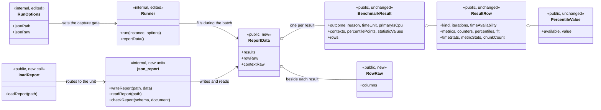
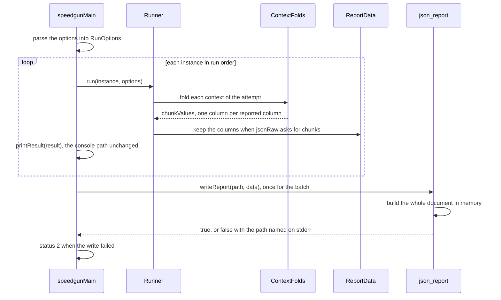
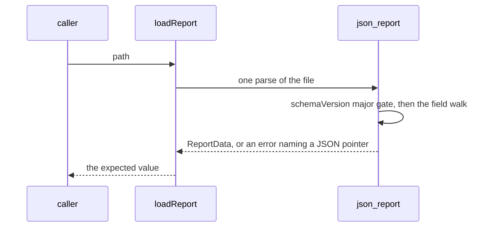
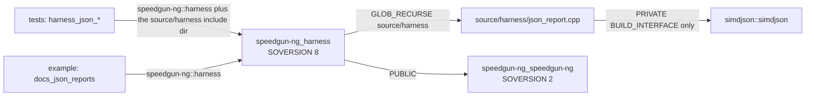

# Implementation Plan: JSON Reports

**Branch**: `023-json-reports` | **Date**: 2026-10-20 | **Spec**: [spec.md](spec.md)

**Input**: Feature specification from `specs/023-json-reports/spec.md`

## Summary

The harness already owns the whole measurement a report needs:
`Runner::run` answers one `BenchmarkResult` per instance and
`speedgunMain` prints it through `detail::printResult`
(`source/harness/cli.cpp:376-411`), and the percentile values, the
aggregate statistics, the labels and the context disclosure all stand in
that value (`include/speedgun-ng/benchmark.hpp:351`, `:440`). The feature
is therefore a formatter and a parser over a value that already exists.
One new translation unit, `source/harness/json_report.cpp`, writes the
document with the vendored `simdjson::builder::string_builder`
(`external/simdjson/include/simdjson/generic/builder/json_string_builder.h:51`)
and reads it back with the vendored DOM parser, and `speedgunMain` calls
the writer once after the last fit row prints, so no byte of I/O stands
inside a timed window.

One gap the audit point found and the clarification closed: the chunk
value columns exist only inside the runner. `ContextFolds::chunkValues`
(`source/harness/runner.cpp:329`, filled at `:1464` to `:1512`) and the
single-context local at `:271` feed `buildPercentileColumns` and are
dropped. The plan keeps them in a `RawColumns` record the `Runner` holds
beside the results, so the public layout of `ResultRow` and
`BenchmarkResult` keeps its fields and the writer, and the loader, read
the same record shape.

## Technical Context

**Language/Version**: C++23, the GCC and Clang versions the CI matrix
pins. The standard-first rule of Principle I decides every construct, and
`std::expected` carries the loader's failure.

**Primary Dependencies**: the vendored simdjson 4.6.11 for both directions
(`json_string_builder.h:51` for writing, the DOM parser for reading), and
the repository's own result types. No new external dependency, and the
static-reflection builder stays out of the feature (research D-03).

**Storage**: one JSON file per run at the path the user names, and one
schema file in the repository at `docs/schema/report-v1.json`. Nothing
else is written.

**Testing**: the harness tests in `test/source/` on `FakeProvider`, the
shape gates `test/cli_shape.sh`, `test/loop_shape.sh`,
`test/time_source_gate.sh`, the docs gates `tools/docs/example_drift.py`
and `tools/docs/report_shape.py`, and the vendored privacy proofs
`simdjson_purity_scan` and `simdjson_nm_proof`
(`test/CMakeLists.txt:88`, `:89`).

**Target Platform**: Linux x86-64; `ci-ubuntu` and `ci-rocky`.

**Project Type**: library plus harness, one package, no service.

**Performance Goals**: zero per-iteration cost. The per-iteration
instruction cycle the loop gate measures stays at the `c7f1769` value,
and the writer runs once per process after the batch.

**Constraints**: no allocation and no I/O inside a timed window
(FR-032); the console report keeps its bytes at every setting of the new
options (FR-003); the install tree, the package files and the dynamic
symbol table stay free of simdjson (FR-048); the writer reads no clock
(FR-005).

**Scale/Scope**: 2 new source files, 4 edited source files, 1 new CMake
link line, 1 new schema file, 3 new test files, 2 edited test files, 1 new
docs example pair, 2 new command-line options, 1 new public call.

## Constitution Check

*GATE: Must pass before Phase 0 research. Re-check after Phase 1 design.*

| Principle | Requirement | Status | Evidence / plan reference |
|---|---|---|---|
| I. Standard-first | No non-standard construct where the standard library serves | PASS | the loader answers `std::expected`, the writer uses the vendored builder, and no intrinsic header or `asm` site enters the feature, so no P2 exception is registered |
| II. Design by Contract | Contracts on every new function; zero drifted interfaces | PASS | `contracts/report-writer.md` and `contracts/report-loader.md` carry the `\pre` and `\post` of each new function; the DBC pair gate covers the new signatures |
| III. R-DCUT | Requirements, design, code, tests, docs traceable | PASS | FR to D to E to T to contract mapping in this plan, `research.md`, `data-model.md`, `contracts/`, `tasks.md` |
| IV. Documentation | Docs with the feature; runnable snippets; main-page impact | PASS | `contracts/page-and-examples.md`: the JSON reports section, its `example/docs/json_reports.cpp` region, its quick-reference rows, the `docs/pages/harness.md` detail, and the measured cap move |
| V. Code style | clang-format, clang-tidy, cppcheck, naming | PASS | the new files follow the harness include shape (`"detail/json_report.hpp"`) and the camelCase rule of V.1 |
| VI. Coverage | 100% line and branch, no exclusion | PASS | every branch of the writer, the reader and the option scan is a case in `tasks.md` Phase 9; no `LCOV_EXCL` under `source/harness/` |
| VII. Performance discipline | Measured claims, distributions, long tails | PASS | the feature publishes the distribution N1 measured; the cost claim is zero per-iteration work, proven by `test/loop_shape.sh` and the allocation counter |
| VIII. Hard CI gates | Every gate green | PASS | `quickstart.md` runs the full set, the two privacy proofs included |
| IX. Spec-driven | EARS requirements, user stories, this gate | PASS | spec.md carries 50 FRs, 6 stories, 12 SCs, 13 decisions and 5 clarifications; this gate is the record |
| X. Anti-slop | No speculative abstraction; smallest fit | PASS | research D-01, D-05, D-08: one translation unit, no validator library, no class hierarchy, no streaming reader |
| XI. Discourse | Prose and commit rules | PASS | `prose-lint` over every artifact; the commit template stands in `tasks.md` |
| Additional Constraints | Counters-only | PASS | the writer reads no clock and samples nothing; the version and build type come from the compile definitions of `CMakeLists.txt:203-208`; `test/time_source_gate.sh` stays clean |

**Gate outcome**: PASS, no violations, so the Complexity Tracking table
stays empty. No new library target, no fourth project, no new `asm` site.

**Post-Design Re-check**: PASS, with three consequences the design
surfaces and the spec carries.

1. The harness `SOVERSION` moves 7 to 8 (research D-16): the load call is
   public API in the harness archive and the constitution's Refactoring
   and Evolution rule makes a public API change a versioned change. No
   exported struct layout moves, because the raw columns travel beside the
   result (D-07). The `speedgun-ng` archive `SOVERSION` stays 2.
2. The exit-status contract of `specs/015-benchmark-harness-core` gains a
   row, and the postcondition at `source/harness/cli.cpp:415` gains its
   third case (research D-10). FR-050 carries the edit.
3. `RunOutcome` has three values, `MEASURED`, `SKIPPED` and `FAILED`
   (`include/speedgun-ng/benchmark.hpp:76-81`), and an interrupted run
   reports as skipped (`specs/015-benchmark-harness-core/contracts/cli.md:103-108`).
   The spec's edge-case bullet named two outcomes that do not exist; the
   `/speckit.analyze` pass of 2026-10-20 rewrote it to the three that do.

## Project Structure

### Documentation (this feature)

```text
specs/023-json-reports/
├── spec.md
├── plan.md
├── research.md          # D-01 to D-17
├── data-model.md        # E-01 to E-12
├── quickstart.md
├── checklists/requirements.md
├── contracts/
│   ├── report-writer.md      # the document, the key order, the file write
│   ├── report-loader.md      # the public call, the error channel, the round trip
│   ├── report-options.md     # the two options, the precedence, the exit statuses
│   ├── schema-file.md        # docs/schema/report-v1.json and its checker
│   └── page-and-examples.md  # the main page, the example, the budget
└── tasks.md             # T001 to T049
```

### Source Code (repository root)

```text
docs/
  schema/report-v1.json         # NEW: the JSON Schema 2020-12 document

include/speedgun-ng/
  benchmark.hpp                 # EDIT: the public load call and ReportData
                                #       (public, harness SOVERSION 8)

source/harness/
  json_report.cpp               # NEW: the writer, the reader, the name tables
  detail/json_report.hpp        # NEW: RawColumns, ReportData, the internal
                                #       writer and reader declarations
  detail/internal.hpp           # EDIT: RunOptions gains jsonPath and jsonRaw;
                                #       Runner gains the raw column record
  runner.cpp                    # EDIT: the capture gate widens, the folds'
                                #       chunk columns are kept
  cli.cpp                       # EDIT: --json= and --json-raw=, the writer
                                #       call, the status 2 case
  report.cpp                    # UNCHANGED: no console printer moves

CMakeLists.txt                  # EDIT: the harness target gains the vendored
                                #       include path as a build-interface-only
                                #       dependency; VERSION and SOVERSION

example/docs/
  json_reports.cpp              # NEW: the docs example with its region
  json_reports.expected         # NEW: the fields its result sentence names

test/source/
  harness_json_report_test.cpp  # NEW: the writer, the key order, the values
  harness_json_load_test.cpp    # NEW: the reader, the error forms, the round trip
  harness_json_schema_test.cpp  # NEW: the schema checker over a written file
  harness_cli_test.cpp          # EDIT: the two options and the exit-2 forms
  harness_capture_test.cpp      # EDIT: the widened capture gate
```

**Structure Decision**: the writer and the reader share one translation
unit, because both sides of a format must agree on the key order and the
name tables, and one file keeps that agreement in one list; two files
would carry two.
The unit sits in the harness archive, which globs `source/harness/*.cpp`
(`CMakeLists.txt:191`), so no source list is edited. The public load call
sits in `benchmark.hpp` beside `speedgunMain`, because it answers the
public result types. `report.cpp` is untouched: the console printers are
N4's edit surface, and the file's values come from the same result value
the printers read.

## Design: UML and Logical View

*One format, two directions, one value between them: `ReportData`.*

### Class diagram (the surface the feature adds and the values it reads)



`ReportData` and `RowRaw` are the only new public types, and they carry
the raw chunk columns beside the result types, so no existing class moves
its layout (D-07). `loadReport` is the only new public call (D-08). The
`suite` and `case` pair the document reuses was placed in
`BenchmarkResult` for this feature by
`include/speedgun-ng/benchmark.hpp:434-438`.

### Sequence: one batch with `--json=out.json --json-raw=chunks`



Every timed window opens and closes inside `run`, so the writer stands
outside all of them (FR-032, D-09). The interrupt path reaches the same
call, because the run loop ends on the interrupt flag and the batch's
results stand (FR-004).

### Sequence: the load path



## Design: Physical View

*Where it lives: the tree under Project Structure, plus the link edges
and the public surface.*

### Files and their duties

| Path | Duty | Requirements |
|---|---|---|
| `source/harness/json_report.cpp` | The writer, the reader, the six name tables, the schema checker | FR-001..FR-027, FR-033, FR-042 |
| `source/harness/detail/json_report.hpp` | The internal declarations the CLI and the tests reach | FR-008, FR-022 |
| `include/speedgun-ng/benchmark.hpp` | `ReportData`, `RowRaw`, `loadReport` | FR-018, FR-022, FR-044 |
| `source/harness/detail/internal.hpp` | `RunOptions` fields, the `RawSetting` bits, the runner's record | FR-018, FR-028, FR-029 |
| `source/harness/runner.cpp` | The widened capture gate and the retained folds | FR-018, FR-020 |
| `source/harness/cli.cpp` | The two options, the one writer call, the status 2 case | FR-001, FR-028..FR-031, FR-050 |
| `docs/schema/report-v1.json` | The schema the gate reads | FR-007, FR-008 |
| `CMakeLists.txt` | The build-interface link, the version, the `SOVERSION` | FR-043, FR-044, FR-048 |
| `test/source/harness_json_*.cpp`, `harness_cli_test.cpp`, `harness_capture_test.cpp` | The test plan below | SC-001..SC-010 |
| `example/docs/json_reports.cpp`, `README.md`, `docs/pages/harness.md`, `tools/docs/example_drift.py` | The page, the region, the rows, the budget | FR-036..FR-041 |

### Build targets and link edges



Three properties carry the design. The vendored headers reach exactly one
translation unit, so the install tree, the package files and the dynamic
symbol table stay free of simdjson and the two privacy proofs pass
unchanged (FR-048, specs/004 FR-013 to FR-016). The harness archive globs
its sources (`CMakeLists.txt:191`), so the new unit needs no source list.
The tests reach the schema checker through the harness include directory,
the pattern `test/CMakeLists.txt:504` and `:522` already use, because a
test translation unit may not include the vendored headers.

### Public API surface added

Namespace `sg` in `include/speedgun-ng/benchmark.hpp`: `ReportData`,
`RowRaw`, and the call `loadReport`. Nothing else becomes public, and no
existing public type changes its layout, which is why the version move
lands on the harness archive alone (D-16).

## Sources & References

- **Spec**: `specs/023-json-reports/spec.md` - FR-001 to FR-050, SC-001
  to SC-012, the thirteen decisions and the five clarifications of
  2026-10-20
- **Constitution**: `.specify/memory/constitution.md` - Principle I, II,
  IV.1, VI, VII, VIII, X, the Additional Constraints, and the Refactoring
  and Evolution rule that moves the `SOVERSION`
- **Prior specs**: `specs/021-percentiles-raw-capture/` for the percentile
  values, the chunk pair and the capture gate;
  `specs/020-execution-contexts-core/` for the context disclosure and the
  noise warning; `specs/019-harness-user-counters-and-statistics/` for the
  statistics and the counter disclosure;
  `specs/015-benchmark-harness-core/contracts/cli.md` for the option table
  and the exit statuses; FR-013, FR-014, FR-015, FR-016 and
  FR-017 of `specs/004-vendor-simdjson/spec.md` for the vendored include
  and privacy rules
- **Code anchors read at `c7f1769`**: `BenchmarkResult`, `ResultRow`,
  `PercentileValue`, `ContextDisclosure`, `Statistics`, `MetricValue`,
  `StatisticValue`, `FitRow`, `RunOutcome`, `RowKind`, `TimeUnit` and
  `StatUnit` in `include/speedgun-ng/benchmark.hpp:65-502`; `Availability`
  in `include/speedgun-ng/counters_core.hpp:87`; `WaitMode` in
  `include/speedgun-ng/execution_context.hpp:91`; `RunOptions`, `Runner`
  and the print declarations in `source/harness/detail/internal.hpp:324-396`;
  `ContextFolds` and the chunk build in `source/harness/runner.cpp:271`,
  `:329`, `:1441-1512`; the option scan, the run loop and the status
  postcondition in `source/harness/cli.cpp:249-418`; the console printers
  in `source/harness/report.cpp:138-400`; `string_builder` in
  `external/simdjson/include/simdjson/generic/builder/json_string_builder.h:51`
  and its number path at `json_string_builder-inl.h:749`; the vendored
  import, merge and link in `CMakeLists.txt:109`, `:161`, `:170`, `:197`
- **Reference read**: Google Benchmark writes no machine-readable report,
  so no upstream schema exists to copy. The schema this feature defines
  follows the field order of the repository's own result types, which is
  the order N5 will read.

## Phase 0: Design Decisions

See [research.md](research.md) for D-01 to D-17 with rationale and the
rejected alternatives.

## Phase 1: Data Model & Contracts

- [data-model.md](data-model.md): E-01 to E-12 with the field list of the
  document, the key order, the `null` rule and the raw column record.
- [contracts/report-writer.md](contracts/report-writer.md): the document
  shape, the key order, the number format, the file write and its failure.
- [contracts/report-loader.md](contracts/report-loader.md): the public
  call, its error channel, the version refusal and the round trip.
- [contracts/report-options.md](contracts/report-options.md): the two
  options, the capture gate they set, and the exit-status table.
- [contracts/schema-file.md](contracts/schema-file.md): the schema
  document, the checker that reads it, and the privacy rule it must not
  break.
- [contracts/page-and-examples.md](contracts/page-and-examples.md): the
  main-page section, the runnable region, the quick-reference rows and the
  line budget.

## Task Planning Summary

See [tasks.md](tasks.md) for T001 to T049. Summary:

- **Phase 1 Setup**: 4 tasks - the schema file, the internal report types,
  the `RunOptions` fields, and the vendored include path for the harness.
- **Phase 2 Foundation**: 11 tasks - the name tables, the scalar writers,
  the row writer, the result writer, the document writer and its file
  path, the DOM read skeleton and version gate, the result and row
  readers, the raw column pair, and the public load call.
- **Phase 3 to 8 User stories**: 29 tasks - US1 the written file, US2 the
  load and the round trip, US3 the raw chunk columns, US4 the error forms
  and the exit statuses, US5 the byte-stable diff, US6 the page.
- **Phase 9 Polish**: 6 tasks - the gates, the version and `SOVERSION`,
  the contract row, the budget, the sanitizer and coverage runs, and the
  final prose pass.

## Implementation Strategy

MVP: Phases 1 and 2 plus US1: one run of a scripted suite with
`--json=<path>` leaves one file that validates against
`docs/schema/report-v1.json` and carries every benchmark's rows, labels,
statistics and percentile values. That slice carries the writer, the
schema, the key order and the number format, so every later story adds a
reader, a column, an option or a page to it and changes nothing else.

Delivery order: US1 (the file, because everything else reads it), then
US2 (the load and the byte-identical round trip, because it proves the
writer), then US4 (the error forms and the status row, because they close
the CLI contract), then US3 (the raw columns, the one storage decision),
then US5 (the byte-stable diff, a test over what US1 and US2 already
write), then US6 (the page, last, because it quotes the final shape).

## Test Plan

The gates run in the order `quickstart.md` states them. The unit oracles:

- `test/source/harness_json_report_test.cpp` drives the writer over a
  scripted `FakeProvider` suite and asserts the document's key order, the
  value of every field against the same run's `BenchmarkResult`, the
  `null` form of an unavailable percentile, the whole placement text
  beside the console's cut, and the three outcome values.
- `test/source/harness_json_load_test.cpp` drives the reader over files
  the writer produced and over hand-written broken files: empty,
  truncated, invalid JSON, an unknown major version, a missing required field,
  a field of the wrong type, and a chunk column whose size disagrees with
  the chunk count. It closes with the round trip: write, load, write, and
  a byte comparison.
- `test/source/harness_json_schema_test.cpp` reads
  `docs/schema/report-v1.json` and checks the written document's key set,
  key order and value kinds against it, with no validator library.
- `test/source/harness_cli_test.cpp` gains the two options, the exit-2
  forms, the precedence of status 2 over a failed benchmark, and the rule
  that no option writes no file.
- `test/source/harness_capture_test.cpp` gains the widened capture gate:
  `--json-raw=chunks` with percentile output off captures the chunk
  values and prints no percentile line.
- `test/loop_shape.sh` and `test/time_source_gate.sh` stay clean over the
  edited files, and the allocation counter in the report test reports
  zero allocations across a timed window with the raw option at `chunks`.
- `tools/docs/example_drift.py` and `tools/docs/report_shape.py` stay
  clean over the new section, its region and its owner example.
