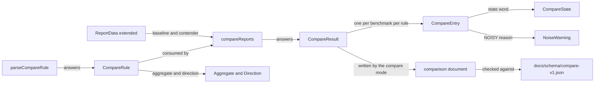

# Data Model: Regression Gate

**Date:** 2026-10-21 · **Spec:** [spec.md](./spec.md)

Entities E-01 to E-12 extend the spec's Key Entities to the C++ types
and the document the code needs. Public types are declared in
`include/speedgun-ng/benchmark.hpp` (D-01); internal ones are named
where they stand. Field spellings follow N-12 (camelBack members) and
N-4 (UPPER_SNAKE enumerators).

## E-01: `CompareRule`, the parsed rule

A public struct, the value `parseCompareRule` answers and
`compareReports` consumes.

| Field | Type | Invariant |
|---|---|---|
| `text` | `std::string` | the exact text the parse call read (D-08); the table, the fault lines and the document print it |
| `valueName` | `std::string` | the value name as written: `time`, `real_time`, `cpu_time`, `p<point>`, or the prefix plus the unescaped label for `counter:`, `metric:`, `stat:` |
| `aggregate` | `std::optional<Aggregate>` | empty when the text wrote no `@` suffix; a written suffix on a `p<point>` or `stat:` name is a parse fault (spec D-21) |
| `direction` | `Direction` | `LOWER_IS_BETTER` or `HIGHER_IS_BETTER` |
| `relativeThreshold` | `std::optional<double>` | the fraction the percent spelled (`5%` answers `0.05`); empty when the text wrote none |
| `absoluteThreshold` | `std::optional<double>` | the number the `abs=` marker spelled, in the stored unit of the value (spec D-22); empty when the text wrote none |
| `filter` | `std::string` | the filter text, empty when the rule wrote none |

At least one of the two thresholds stands in every parsed rule: a
threshold field with neither form is a parse fault (FR-022, FR-023).

## E-02: `CompareEntry`, one benchmark under one rule

A public struct; the table row and the document entry.

| Field | Type | Invariant |
|---|---|---|
| `name` | `std::string` | the full instance name (FR-002) |
| `ruleText` | `std::string` | the `text` of the rule that produced the entry |
| `baseline` | `std::optional<double>` | the baseline value in the stored unit; empty for `ADDED`, `REMOVED` and `SKIPPED` |
| `contender` | `std::optional<double>` | the contender value in the stored unit; empty for `ADDED`, `REMOVED` and `SKIPPED` |
| `changePercent` | `std::optional<double>` | the signed change as a percent of the baseline magnitude; empty when the baseline magnitude is zero or no value stands |
| `changeAbsolute` | `std::optional<double>` | the signed change in the stored unit; empty when no value stands |
| `state` | `CompareState` | one of the seven words (FR-054) |
| `reason` | `std::string` | empty except on `NOISY`, where it names the bound, the carried warning or the running ratio that fired (FR-044) |

The sign convention: `changeAbsolute` is positive when the contender is
worse for the rule's direction, so the word and the sign agree.

## E-03: `CompareResult`, the table and the verdict

A public struct.

| Field | Type | Invariant |
|---|---|---|
| `entries` | `std::vector<CompareEntry>` | baseline order, then names the contender adds in contender order (FR-002); one entry per benchmark per rule |
| `passed` | `bool` | false when any entry is `REGRESSED`, or when `strict` stands and any entry is `NOISY` (FR-044, FR-045); `NOISY` passes while `strict` stands off |

## E-04: `CompareState`, the seven words

A public scoped enum (`std::uint8_t`): `OK`, `REGRESSED`, `IMPROVED`,
`NOISY`, `ADDED`, `REMOVED`, `SKIPPED` (FR-054). The spellings are the
report's outcome words plus `OK`, `REGRESSED` and `IMPROVED`. The
document writes the enumerator name; the table prints it.

## E-05: `Aggregate` and `Direction`

Two public scoped enums (`std::uint8_t`).

- `Aggregate`: `MEDIAN`, `MEAN`, `MIN`, `MAX`, read from the statistics
  record the report carries (FR-016). The default when a statistics
  name carries no suffix is `MEDIAN` (FR-016).
- `Direction`: `LOWER_IS_BETTER`, `HIGHER_IS_BETTER` (FR-012).

## E-06: `NoiseWarning`, the carried warning record

The struct moves from `source/harness/detail/json_report.hpp:137` to
the public header with its fields unchanged: `spinning`
(`std::uint64_t`), `runnableCpus` (`std::uint64_t`), `sharesOneCpu`
(`bool`) (FR-070, D-05). The predicate `noiseWarningOf` stays internal;
the record is data.

## E-07: `ReportData`, extended

The struct at `include/speedgun-ng/benchmark.hpp:553` keeps `results`,
`rowRaw` and `contextRaw` and gains three fields (D-04):

| Field | Type | Invariant |
|---|---|---|
| `schemaVersion` | `std::string` | the text the document's `schemaVersion` carried; empty for a value no document produced |
| `speedgunVersion` | `std::string` | the text under the document's `speedgun` header at `version`; empty when the document omitted it |
| `noiseWarnings` | `std::vector<std::optional<NoiseWarning>>` | one entry per entry of `results` when the load call fills it; the entry holds nothing when the document carried no warning for that result |

The load call fills all three; the report writer ignores them and keeps
stamping its own values (`source/harness/json_report.cpp:28`, `:530`),
so 023's byte-identical round trip stands. The run path leaves them
empty. The comparison call reads them.

## E-08: The value name space

The names one rule can carry, and where each value stands in a result:

| Name | Value | Statistics record |
|---|---|---|
| `time` | the primary column: `cpuTimePerIterationNs` when `primaryIsCpu`, `timePerIterationNs` when it does not | `ResultRow::timeStats` |
| `real_time` | `ResultRow::timePerIterationNs` | `timeStats` when the primary is real; none otherwise (spec D-18) |
| `cpu_time` | `ResultRow::cpuTimePerIterationNs` | `timeStats` when the primary is cpu; none otherwise (spec D-18) |
| `p<point>` | the chosen row's `percentiles` cell for column 0 at the point's index in `percentilePoints` (spec D-16) | none |
| `counter:<label>` | the column of `ResultRow::counters` at the label's index in `counterLabels` | `BenchmarkResult::counterStats` at that index |
| `metric:<label>` | `MetricValue::value` at the label's index in `metricLabels` | `ResultRow::metricStats` at that index |
| `stat:<name>` | `StatisticValue::value` for the name in `statisticValues` | none |

Stored units (spec D-22): nanoseconds per iteration for the time
columns, a percentile cell and a `TIME` statistic; percentage points
for a `PERCENTAGE` statistic (`StatUnit`,
`include/speedgun-ng/benchmark.hpp:249`); the counter's own
value for a counter or metric column. A printed-unit difference between
the two reports changes no comparison (FR-027).

Row selection (D-09): the `AGGREGATE` row when the result carries one
(`source/harness/runner.cpp:2163`), the single measured row when it
carries none. A result with no readable row, a fit entry
(`source/harness/runner.cpp:2436` to `:2466`) or a non-measured
`RunOutcome`, answers `SKIPPED` (spec D-20).

## E-09: The threshold pair and the delta

For a matched pair with values `b` and `c` and a rule direction:

- `delta` is `c - b` for `LOWER_IS_BETTER` and `b - c` for
  `HIGHER_IS_BETTER`, so a positive `delta` is worse.
- The relative test: `delta / |b|` exceeds the relative threshold.
- The absolute test: `delta` exceeds the absolute threshold.
- With both thresholds the row regresses when both are exceeded
  (spec D-4).
- `delta` below zero answers `IMPROVED`; zero answers `OK`; an exceeded
  test answers `REGRESSED` (FR-026 to FR-030).
- A zero baseline magnitude with a relative threshold is a fault
  (FR-031); with the absolute threshold alone the absolute test answers
  alone and the percent prints `n/a` (D-18).

The noise guard runs before the verdict words: a carried warning, an
over-bound `coefficientOfVariation` against the relative threshold or
an over-bound `sampleStdDev` against the absolute threshold in either
report, or a metric `runningRatio` below one in either report, marks
the row `NOISY` (D-11, FR-041 to FR-046).

## E-10: The comparison document

The document `--json=` writes in compare mode (FR-057), checked against
`docs/schema/compare-v1.json`. Top-level keys in `x-order`:

| Key | Content |
|---|---|
| `schemaVersion` | `1.0`, a constant in `source/harness/compare.cpp` |
| `speedgun` | `version` and `buildType` from the compile definitions, the writer's form (`source/harness/json_report.cpp:530` region) |
| `inputs` | `baseline` and `contender`: the two paths as the option gave them |
| `rules` | the rule texts, in the order the rules stand (the default rule's text when none was given) |
| `entries` | one object per `CompareEntry`: `name`, `rule`, `baseline`, `contender`, `changePercent`, `changeAbsolute`, `state`, `reason`; the optional fields write `null` when empty |
| `verdict` | `passed`: the boolean |

Values stand in the stored unit with no printed scaling. The document
carries no date, so two runs of one command write the same bytes
(SC-009).

## E-11: `RunOptions`, extended

The internal struct at `source/harness/detail/internal.hpp:430` gains:

| Field | Type | Invariant |
|---|---|---|
| `compareBaseline` | `std::string` | the path before the first comma in `--compare=`; empty when the mode stands off |
| `compareContender` | `std::string` | the path after that comma; a missing comma or an empty side is a usage fault at the scan |
| `compareRules` | `std::vector<CompareRule>` | one entry per `--compare-rule=`, in order (FR-049); empty means the default rule |
| `compareStrict` | `bool` | the `--compare-strict` flag |

## E-12: The filter scoping

Two filters scope the comparison (FR-050, FR-024):

- The batch filter: `--filter` in compare mode, applied by the command
  line to the two loaded values before the call (D-12). Its regex
  compile reuses the run path's rule (`source/harness/cli.cpp:437` to
  `:453`); an invalid pattern answers the same line and status 2.
- The rule filter: each rule's `filter`, a `std::regex` over the full
  instance name, the same matching as the batch filter
  (`source/harness/cli.cpp:453`). An invalid pattern is a rule fault.

A rule whose written filter matches no benchmark in either report
faults with status 2 (FR-039). An empty pair with no written filter
answers the empty table and status 0 (D-19).

## Entity graph

