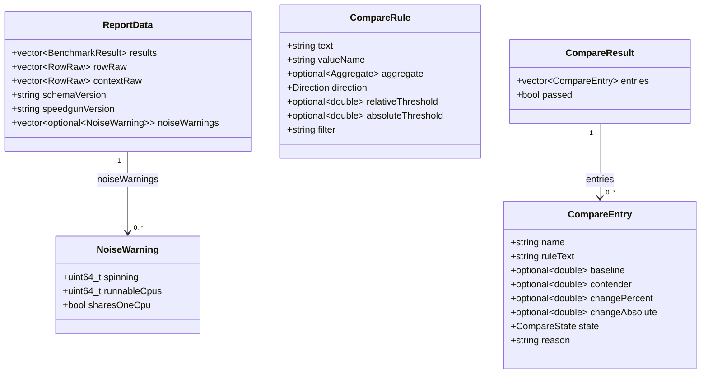
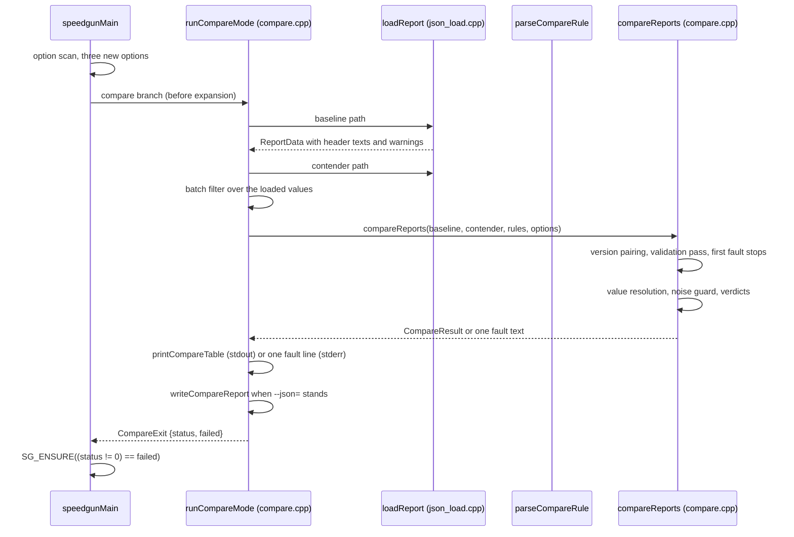

# Implementation Plan: Regression Gate

**Branch**: `026-regression-gate` · **Date**: 2026-10-21 ·
**Spec**: [specs/026-regression-gate/spec.md](./spec.md)

**Note**: The `dev` presets are machine-local and absent from a fresh
clone, so every command in this plan and in [quickstart.md](./quickstart.md)
runs the checked-in `ci-rocky` release preset.

## Summary

`--compare=<baseline>,<contender>` loads two JSON report documents the
harness already writes, matches benchmarks by full instance name,
applies rules that each name one value of the report, an aggregate, a
direction and a threshold, prints a comparison table with the state
words `OK`, `REGRESSED`, `IMPROVED`, `NOISY`, `ADDED`, `REMOVED`,
`SKIPPED`, and answers exit 0 pass, 1 regression, 2 usage, rule, load,
schema or value fault. With no rule the gate applies
`time@median:lower:5%`. One exported call parses one rule text, so the
command line and library users read the same grammar, and one exported
call compares two loaded `ReportData` values under a list of rules and
answers the same table and verdict the command line prints. The load
call gains the three fields the comparison needs from the document:
the two header texts and the noise warning the report already carries.
The report writer, the run path and the per-iteration path do not
change.

**Execution mode**: TDD (Principle III). Every test task is written and
observed failing before the code task that turns it green exists, and
each test task in `tasks.md` names the run that fails red first.

## Technical Context

| Item | Value |
| --- | --- |
| Language | C++23, the project's existing standard |
| Build | CMake 3.20 or newer; presets `ci-rocky`, `ci-ubuntu`, `ci-sanitize`, `ci-tsan`, `ci-coverage`; `binaryDir` values `build`, `build/sanitize`, `build/tsan`, `build/coverage` (`CMakePresets.json:80` to `:135`) |
| Targets | `speedgun-ng_harness` (archive, `SOVERSION` 8 to 9, `CMakeLists.txt:247`); `speedgun-ng_speedgun-ng` (archive, `SOVERSION` 2, unchanged, `:47`); the harness sources come from `GLOB_RECURSE` at `:191`, so a new `source/harness/*.cpp` needs no CMake edit |
| JSON | simdjson 4.6.11 vendored at `external/simdjson`, the only JSON library: the reader's DOM error-code form `x.get(out)` and the builder's `string_builder` (`source/harness/json_report.cpp:25`); no new library, no in-house parser or emitter, no throwing `.value()` getter |
| Standard library | `std::expected`, `std::optional`, `std::regex`, `std::from_chars`, `std::string_view` |
| CLI | `getopt_long` table in `speedgunMain` (`source/harness/cli.cpp:321` to `:344`); three new entries |
| Tests | standalone binaries under `test/source/` with `add_test` entries in `test/CMakeLists.txt`; fixture JSON documents under a new `test/data/` passed as a path argument, the shape of `test/CMakeLists.txt:82` |
| Docs gates | `tools/docs/example_drift.py` with `PAGE_LINE_CAP` 713 (`:132`), `SECTION_LINE_CAP` 25 (`:133`), `SECTIONS` (`:30` to `:54`), `SECTION_OWNERS` (`:59`) |
| Platforms | Linux, GCC and Clang; the CI matrix of Principle VIII |

## Constitution Check

*GATE: Must pass before Phase 0 research. Re-check after Phase 1 design.*

| Principle | Result | Evidence |
| --- | --- | --- |
| I, standard-first P0 to P3 | PASS | the comparison uses the standard library and the vendored simdjson already at the harness's core; no new dependency enters |
| II, Design by Contract | PASS | every new public declaration carries a Doxygen docstring with `\pre` and `\post` markers and `specs/026-regression-gate` plus `FR-nnn` traces, the shape of `loadReport` (`include/speedgun-ng/benchmark.hpp:2330`); the compare branch carries an `SG_ENSURE` postcondition (D-15) |
| III, R-DCUT | PASS | the spec's 74 EARS requirements carry ids; the execution mode is TDD, recorded above and in `tasks.md`; every contract file names the ids it closes |
| IV.1, main-page obligations | YES impact | a `Regression gate` section, quick-reference rows and option rows land in the same change ([contracts/page-and-examples.md](./contracts/page-and-examples.md)) |
| V, style and naming | PASS | `CompareRule`, `CompareEntry`, `CompareResult`, `CompareState`, `Aggregate`, `Direction` in PascalCase; `parseCompareRule`, `compareReports` in camelBack; UPPER_SNAKE enumerators; camelBack data members (N-1, N-2, N-4, N-12) |
| VI, coverage | PASS | 100% lines and 100% branches through `tools/dbc/coverage_gate.sh`, no `LCOV_EXCL`; every fault branch and optional read carries a test (Test Plan) |
| VII, performance discipline | PASS | the feature touches no per-iteration path; `test/loop_shape.sh` must print its base reading (FR-072, PC-11); the comparison runs once after the run |
| VIII, hard CI gates | PASS | the Implementation Strategy schedules every gate: both release builds, `ctest -j 2`, sanitizers, tsan, coverage, format, spell, prose, the three shape gates, the drift gate and the DBC gates |
| IX, spec-driven development | PASS | this artifact set follows the clarified spec |
| X, anti-slop | PASS | the plan reuses the report reader, the schema checker `checkReport` (`source/harness/json_load.cpp:1083`), the unit scale and printers of `source/harness/report.cpp`, the pattern rule of `--filter` (`source/harness/cli.cpp:529` to `:536`) and the test helper `sameValue` (`test/source/detail/json_fixture.hpp:48`); one new translation unit |
| XI, prose law | PASS | the artifacts pass `tools/prose/prose_gate.py` with zero findings |

**Re-check after Phase 1**: the design grows the public surface of the
harness archive and changes the layout of the public struct
`ReportData`, so the harness `SOVERSION` moves 8 to 9
(`CMakeLists.txt:247`) and the library archive stays 2 (`:47`); the
project `VERSION` at `:7` (0.14.0 at the base) takes the next free
minor at rebase time. The CLI contract table
(`specs/015-benchmark-harness-core/contracts/cli.md:83` to `:101`) gains
the compare-mode rows. No gate fails on the design.

## Project Structure

New and changed files, `source/`, `include/`, `test/`, `example/` and
`docs/` touched only by the implement step:

```text
include/speedgun-ng/benchmark.hpp        public types, the two calls, ReportData fields,
                                         the NoiseWarning move (D-01, D-05)
source/harness/compare.cpp               grammar, resolution, validation, engine,
                                         table, document, runCompareMode (new, D-02)
source/harness/detail/compare.hpp        internal declarations (new)
source/harness/detail/internal.hpp       RunOptions gains four fields (E-11)
source/harness/cli.cpp                   three options, the compare branch (D-15)
source/harness/json_load.cpp             reader extension (contracts/reader-extension.md)
source/harness/detail/json_report.hpp    NoiseWarning include, predicate unchanged
docs/schema/compare-v1.json              the comparison schema (new)
README.md                                section, quick-reference rows, option rows
docs/pages/harness.md                    guide section after `JSON reports` (:1018)
example/docs/regression_gate.cpp         the section's example (new)
example/docs/regression_gate.expected    its recorded lines (new)
example/CMakeLists.txt                   add_docs_example(regression_gate)
test/data/*.json                         fixture report documents (new)
test/source/harness_compare_test.cpp     parse, engine, guard (new)
test/source/harness_compare_cli_test.cpp options, status, table, document (new)
test/CMakeLists.txt                      two targets, five lines each, fixture path
CMakeLists.txt                           VERSION, harness SOVERSION 8 to 9
```

## Design: UML and Logical View

The public value types and their relations:



The compare mode's flow, one pass through the entry point:



The logical rules close in order: the grammar (D-06, D-07) produces
`CompareRule`; the validation pass (FR-035 to FR-040) answers faults
before any entry exists; the value resolution (E-08, D-09, D-10) reads
the aggregate row or the single row; the threshold pair and the noise
guard (E-09, D-11) answer the state word; the verdict (E-03) answers
`passed`.

## Design: Physical View

| Artifact | Duty |
| --- | --- |
| `include/speedgun-ng/benchmark.hpp` | the public surface: six types, two calls, three `ReportData` fields, the moved `NoiseWarning`, each declaration with its docstring and traces |
| `source/harness/compare.cpp` | the whole internal mechanism: grammar, resolution, validation, engine, table printer, document writer, `runCompareMode` |
| `source/harness/detail/compare.hpp` | `CompareExit`, `runCompareMode`, `printCompareTable`, `writeCompareReport`, the default rule text |
| `source/harness/cli.cpp` | three `longOptions` entries, the scan-time parse of `--compare` and `--compare-rule`, the branch with its `SG_ENSURE` |
| `source/harness/json_load.cpp` | stores the header texts and the warning records it already parses |
| `docs/schema/compare-v1.json` | the schema the checker reads; `x-order`, `required`, inlined definitions |
| `test/data/` | fixture report documents for the CLI tests and the quickstart |
| `test/source/harness_compare_test.cpp` | the library surface over values built in code |
| `test/source/harness_compare_cli_test.cpp` | the mode end to end, plus `checkReport` over the written document |

Build graph: the harness archive compiles the new unit through the
`GLOB_RECURSE` at `CMakeLists.txt:191` and already links the vendored
simdjson `PRIVATE BUILD_INTERFACE`, so the include path arrives with no
CMake edit and the install-tree and symbol privacy of 004 FR-013 to
FR-017 stand. The two new test targets take the five-command shape of
`test/CMakeLists.txt:569` to `:577`, including
`target_include_directories(... source/harness)` for the detail header.
A harness `.cpp` includes a detail header by its path,
`#include "detail/compare.hpp"`.

Public API surface added (all from the harness archive):

```cpp
enum class CompareState : std::uint8_t;   // OK, REGRESSED, IMPROVED,
                                          // NOISY, ADDED, REMOVED, SKIPPED
enum class Aggregate : std::uint8_t;      // MEDIAN, MEAN, MIN, MAX
enum class Direction : std::uint8_t;      // LOWER_IS_BETTER, HIGHER_IS_BETTER
struct NoiseWarning;                      // moved from the detail header
struct CompareRule;
struct CompareEntry;
struct CompareResult;
struct CompareOptions;
auto parseCompareRule(std::string_view text)
    -> std::expected<CompareRule, std::string>;
auto compareReports(const ReportData& baseline, const ReportData& contender,
                    const std::vector<CompareRule>& rules,
                    const CompareOptions& options)
    -> std::expected<CompareResult, std::string>;
```

## Sources & References

- Spec: [specs/026-regression-gate/spec.md](./spec.md), its own
  decisions D-1 to D-22 and its five clarifications.
- Constitution: [.specify/memory/constitution.md](../../.specify/memory/constitution.md),
  Principles II, III, IV.1, V, VI, VII, VIII, X, XI and the Refactoring
  and Evolution section.
- Neighbor artifacts: [023 plan](../023-json-reports/plan.md),
  [023 contracts](../023-json-reports/contracts/), the CLI exit-status
  table of [015](../015-benchmark-harness-core/contracts/cli.md:83).
- Code anchors, re-read on this branch at `aec8fce` on 2026-10-21:
  `include/speedgun-ng/benchmark.hpp:77`, `:88`, `:212`, `:231`,
  `:274`, `:338`, `:352`, `:441`, `:553`, `:1758`, `:1786`, `:2330`;
  `source/harness/json_load.cpp:729` to `:743`, `:1000` to `:1030`,
  `:1067`, `:1117` to `:1128`; `source/harness/json_report.cpp:25`,
  `:28`, `:400`, `:472` to `:481`, `:485`, `:530`;
  `source/harness/detail/json_report.hpp:137`, `:154`, `:172`, `:188`;
  `source/harness/cli.cpp:262`, `:293` to `:310`, `:371`, `:385`,
  `:406`, `:426`, `:437` to `:453`, `:465` to `:470`, `:566`;
  `source/harness/report.cpp:70`, `:88`, `:193`, `:282` to `:296`,
  `:309`, `:331`; `source/harness/runner.cpp:2131`, `:2163`, `:2195`,
  `:2229`, `:2262`, `:2436` to `:2466`;
  `include/speedgun-ng/counters_core.hpp:87`; `docs/schema/report-v1.json:7`;
  `tools/docs/example_drift.py:30` to `:54`, `:59`, `:132`, `:133`,
  `:138`; `example/CMakeLists.txt:40` to `:47`;
  `test/CMakeLists.txt:82`, `:569` to `:577`, `:1136` to `:1139`;
  `test/cli_shape.sh:31` to `:41`; `CMakeLists.txt:7`, `:47`, `:191`,
  `:247`; `test/source/detail/json_fixture.hpp:48`;
  `test/source/harness_json_report_test.cpp:41` to `:53`.
- One drift from the spec's Citations table, repaired by this analyze
  pass: the option table spans `source/harness/cli.cpp:321` to `:344`,
  the terminator at `:344`; the spec's Citations table and PC-3 first
  cited `:293` to `:311` and now cite `:310`. No other cited anchor
  moved.

## Phase 0: Design Decisions

All twenty decisions stand in [research.md](./research.md) with their
rationales and alternatives:

- D-01: the public comparison surface sits in `benchmark.hpp`.
- D-02: one new translation unit, `source/harness/compare.cpp`.
- D-03: the comparison call answers `std::expected<CompareResult, std::string>`;
  validation before comparison, the first fault stops.
- D-04: `ReportData` carries the two header texts and the warning table;
  the writer keeps its behavior.
- D-05: `NoiseWarning` moves to the public header; the predicate stays internal.
- D-06: the grammar reads a prefixed value name first, escapes inside the label.
- D-07: the threshold field takes one order.
- D-08: the rule value carries its text as given.
- D-09: row selection and the statistics-record rule.
- D-10: percentile cells answer the primary time column.
- D-11: the noise guard reads the value's own statistics record.
- D-12: the batch filter runs in the command-line path before the call.
- D-13: the schema version pairing check lives inside the comparison call.
- D-14: the comparison document reuses the builder and the schema checker.
- D-15: the entry point carries the compare mode through an early branch
  with its own postcondition.
- D-16: the docs example builds two report values in code.
- D-17: the harness `SOVERSION` moves 8 to 9; the archive stays 2.
- D-18: the zero baseline prints `n/a` in the percent column.
- D-19: an empty pair answers an empty table and status 0.
- D-20: the test surface reuses `sameValue` and passes fixtures through
  the test command.

## Phase 1: Data Model & Contracts

Entities E-01 to E-12 with fields and invariants stand in
[data-model.md](./data-model.md). Contracts, one file per public
surface piece:

| Contract | Surface | Closes |
| --- | --- | --- |
| [contracts/compare-call.md](./contracts/compare-call.md) | `compareReports`, `CompareResult`, `CompareEntry`, `CompareState` | FR-001 to FR-003, FR-010 to FR-020, FR-028 to FR-033, FR-035 to FR-040, FR-051 |
| [contracts/rule-parse.md](./contracts/rule-parse.md) | `parseCompareRule`, `CompareRule`, `Aggregate`, `Direction`, the grammar | FR-004, FR-005, FR-012 to FR-027 |
| [contracts/compare-options.md](./contracts/compare-options.md) | the three options, the branch, the exit-status rows | FR-044 to FR-052 |
| [contracts/compare-document.md](./contracts/compare-document.md) | the comparison document, `docs/schema/compare-v1.json`, the checker reuse | FR-057, FR-058, FR-074 |
| [contracts/reader-extension.md](./contracts/reader-extension.md) | the `ReportData` fields, the warning move, the error forms | FR-067, FR-070, FR-073 |
| [contracts/page-and-examples.md](./contracts/page-and-examples.md) | the page, the example, the budget | FR-059 to FR-063 |

The table and fault-line surface (FR-053 to FR-056) is the compare
mode's own output, carried in
[contracts/compare-options.md](./contracts/compare-options.md).

## Task Planning Summary

Task ids land in `tasks.md` when `/speckit.tasks` runs; the phases and
counts the plan commits to:

| Phase | Tasks |
| --- | --- |
| Setup: public types, `ReportData` fields, the detail header and unit, `RunOptions`, the schema file, the fixture documents | 6 |
| Foundation: grammar, resolution, row selection, threshold arithmetic, noise guard, matching, validation, engine, table, document, reader extension, with their tests | 12 |
| US1: options, branch, default rule, status mapping, contract rows, mode tests | 7 |
| US2: value kinds, aggregates, directions, thresholds, filters, fit `SKIPPED` | 6 |
| US3: the fault forms, the one lines, the postcondition | 6 |
| US4: warning, statistics bounds, running ratio, strict | 5 |
| US5: library call tests, document byte identity, schema check, `--json=` in the mode | 5 |
| US6: example, page, guide section, quick reference, drift caps | 5 |
| Polish: version and `SOVERSION`, the full gate run, coverage, sanitizers, prose and spell | 6 |

Fifty-eight tasks, `T001` to `T058`.

## Implementation Strategy

Execution order: the public types and the extended `ReportData` first,
because every other file includes them; then the reader extension,
which the CLI mode and the tests both need; then the grammar and the
engine inside `compare.cpp`; then the table, the document and the
branch; then the docs surface; then version and gates.

- Version and ABI: `CMakeLists.txt:7` takes the next free minor at
  rebase time, 0.15.0 or 0.16.0 by the merge order against N6, which
  reserves 024 on another machine; the harness `SOVERSION` moves 8 to 9
  at `:247`; the archive stays 2 at `:47` (D-17).
- Parallel work: N6 edits `json_load.cpp` for its pass fields. The
  reader extension here touches the noise record and the header only;
  whichever lane merges first rebase-governs, and this feature keeps
  accepting unknown keys inside open objects (FR-073). If N6 lands
  first, this change adds one test that the comparator ignores the pass
  fields.
- The compare mode returns before the run loop, so `test/cli_shape.sh`
  and `test/loop_shape.sh` keep their base readings (PC-11, FR-072).
- Docs land in the same change as the surface they teach (IV.1): the
  section, the example, the quick-reference rows, the option rows, the
  guide section and the recorded `PAGE_LINE_CAP` raise.

## Test Plan

- `harness_compare_test`: the grammar over valid and malformed rule
  texts, the value resolution over `ReportData` values built in code
  for every value kind, the aggregate and single-row forms, the
  threshold pair in both directions, the noise guard's three sources,
  the validation faults, the matching order, the empty pair.
- `harness_compare_cli_test`: the option scan and its usage faults, the
  exit statuses 0, 1 and 2 for each fault class, the table header and
  rows, the one-line faults, `--filter` scoping, the empty-pair line,
  the comparison document: byte identity across two runs and
  `checkReport` against `docs/schema/compare-v1.json`.
- `harness_json_load_test` gains the reader-extension cases: the header
  texts, the stored warning, each error code the extension answers.
- Fixtures: committed JSON documents under `test/data/`, reached
  through a path argument in `add_test`
  (`test/CMakeLists.txt:82` shape), plus `ReportData` values built in
  code. No test sleeps, reads a clock or runs a benchmark; no test
  names a cpu count or host size; none skips. A double comparison goes
  through `sameValue` (`test/source/detail/json_fixture.hpp:48`),
  because `-Werror=float-equal` makes `==` a hard error.
- Gates, all scheduled: `ci-rocky` and `ci-ubuntu` release builds with
  clang-tidy and cppcheck, `ctest --test-dir build -j 2`, `ci-sanitize`,
  `ci-tsan`, the coverage target `cmake --build build/coverage -t
  coverage` driven by `tools/dbc/coverage_gate.sh` at 100% lines and
  100% branches with no `LCOV_EXCL`, `format-check`,
  `cmake -P cmake/spell.cmake`, `cmake -P cmake/prose-lint.cmake`,
  `test/time_source_gate.sh`, `test/loop_shape.sh`, `test/cli_shape.sh`,
  `python3 tools/docs/example_drift.py .`, and the DBC gates. The
  coverage preset keeps `-fprofile-update=atomic` and no
  `-D_GLIBCXX_ASSERTIONS`.
