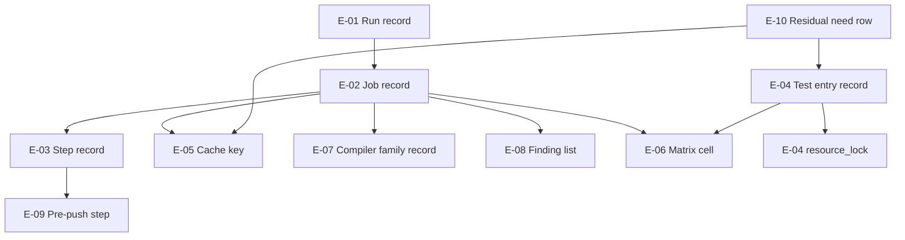

# Data Model: CI Speed-Up

**Date**: 2026-10-25 · **Spec**: [spec.md](./spec.md)

The records below are the data this feature reads and writes. Nothing
here is stored in a database: each record is a workflow run's JSON, a
`ctest` listing, a cache key string, a line of a log, or a row of a
table. The numbering E-01 to E-10 follows the order of the spec's Key
Entities section.

## E-01: Run record

Held by `gh api repos/<repo>/actions/runs/<id>` and
`gh api repos/<repo>/actions/runs/<id>/timing`.

| Field | Type | Source |
| --- | --- | --- |
| `id` | number | run id |
| `head_sha` | string | `head_commit.id` |
| `event` | `push` or `pull_request` | `event` |
| `status` | `completed` or in-flight | `status` |
| `conclusion` | `success`, `failure`, `canceled` | `conclusion` |
| `wall_ms` | number | `run_duration_ms` from the timing endpoint |
| `runner_minutes` | number | sum of `completed_at - started_at` over the completed jobs |

**Invariants.** A canceled run carries no timing that may enter a table
(edge case, story 8). `runner_minutes` excludes skipped jobs, which hold
no timestamps. The before and after tables of FR-051 hold one pair of
these records per compared pair.

**Governed by.** FR-051, FR-052, SC-001, SC-002.

## E-02: Job record

Held by `gh api repos/<repo>/actions/runs/<id>/jobs`, one element per
job.

| Field | Type | Source |
| --- | --- | --- |
| `name` | string | `name` |
| `status` | `completed`, `skipped`, `queued`, `in_progress` | `status` |
| `conclusion` | `success`, `failure`, `skipped`, and the canceled state a superseded run reports | `conclusion` |
| `duration_s` | number | `completed_at - started_at` |
| `steps` | list of E-03 | `steps` |

**Invariants.** The set of names is FR-045's twelve plus
`static-analysis`, so thirteen on a master run. A job whose `needs` were
not satisfied reads `skipped` with no steps, which is how the base head
reached eleven skipped jobs (PC-10, section C of the spec).

**Governed by.** FR-037, FR-038, FR-045, FR-046, FR-063, FR-064, SC-012.

## E-03: Step record

One element of a job record's `steps`.

| Field | Type | Source |
| --- | --- | --- |
| `name` | string | the workflow's step name, verbatim |
| `duration_s` | number | `completed_at - started_at` |
| `conclusion` | `success`, `failure`, `skipped` | `conclusion` |

**Invariants.** `Build` and `Test` are the two names whose readings move
under this change, so they carry the before and after pair in every
table. An install step carries its own time in every run, warm or missed
cache (FR-037). A step name is matched verbatim, so a rename in the
workflow is a change to the tables.

**Governed by.** FR-037, FR-051, FR-052, SC-001, SC-002.

## E-04: Test entry record

One `ctest` entry, read from `ctest -N` output and from the
registration's properties.

| Field | Type | Source |
| --- | --- | --- |
| `name` | string | `add_test(NAME ...)` |
| `tier` | `quick` or `slow`, exactly one | `LABELS` from the list P-05 applies |
| `reason` | text, required when the tier is `slow` | the comment beside the list row |
| `budget_s` | number | `TIMEOUT`, set by the P-07 loop or by the registration |
| `processors` | number, default 1 | `PROCESSORS` |
| `resource_lock` | name, empty when unset | `RESOURCE_LOCK` |
| `skip_rule` | `SKIP_RETURN_CODE` value | kept from master (FR-047) |
| `measured_s` | per lane | the entry's line in that lane's job log |

**Invariants.** Exactly one tier label, no entry without one, and no
entry above its budget in any lane (FR-025, FR-026, FR-033). A budget
other than 300 s appears in the exceptions block with a measured number
(FR-032). `processors` equals the compile concurrency the entry starts
(FR-003). A shared resource implies a lock name (FR-004).

**Governed by.** FR-002 to FR-005, FR-025 to FR-027, FR-031 to FR-034,
FR-047, FR-048, SC-004, SC-008.

## E-05: Cache key

The string D-9 and P-10 define, used as `actions/cache`'s `key`.

| Segment | Value |
| --- | --- |
| prefix | `ccache` |
| job | the job name |
| preset | the configure preset name |
| compiler | a hash of `${CXX:-c++} --version` |
| tree | `hashFiles('CMakePresets.json', 'external/**')` |
| run | `github.run_id`, present in `key`, absent from `restore-keys` |

**Invariants.** One key is written once. A compiler bump, a preset edit or
an `external/` change is a miss, never a wrong object. The directory is
`${{ github.workspace }}/.ccache` in every job. `CCACHE_BASEDIR` and
`CCACHE_SLOPPINESS` are unset (FR-011). A pull request restores and never
saves (FR-008).

**Governed by.** FR-006 to FR-011, FR-035, FR-036, SC-006.

## E-06: Matrix cell

One of the five contract-semantic configurations of
`tools/dbc/semantics_matrix.sh`.

| Cell name in the script | `ndebug` | flag | semantics | expected asserts | build dbc | entry name (P-04) |
| --- | --- | --- | --- | --- | --- | --- |
| `NDEBUG=off_-O0` | off | `-O0` | enforce | 2 | yes | `dbc_matrix_off_o0` |
| `NDEBUG=off_-O2` | off | `-O2` | enforce | 2 | yes | `dbc_matrix_off_o2` |
| `NDEBUG=on_-O0` | on | `-O0` | enforce | 2 | yes | `dbc_matrix_on_o0` |
| `NDEBUG=on_-O2` | on | `-O2` | enforce | 2 | yes | `dbc_matrix_on_o2` |
| `observe_NDEBUG=off_-O0` | off | `-O0` | observe | 1 | no | `dbc_matrix_observe_off_o0` |

**Invariants.** Each cell keeps every check `run_cell` performs (`:154`
to `:322`), and the probe sources are written once per entry (FR-022). A
cell builds in its own `mktemp -d` tree, so no two entries share a build
directory (FR-020). `JOBS` equals the entry's `PROCESSORS`.

**Governed by.** FR-019 to FR-022, SC-004.

## E-07: Compiler family record

One row per lane that registers the matrix, read from that lane's own
configure log.

| Field | Type | Source |
| --- | --- | --- |
| `lane` | `test`, `test-rocky`, `tsan`, `coverage`, `sanitize` | job name |
| `compiler` | version string | the lane's configure log |
| `registers_matrix` | yes or no | the value of `SPEEDGUN_DBC_MATRIX` |
| `evidence` | text | the line of the log that names the version |

**Invariants.** `test` and `coverage` carry one family, `sanitize` and
`tsan` another, and the two lanes that leave the matrix unregistered
share a family with a lane that runs it (D-5, PC-6). The record is read
again at the branch audit point before the split is trusted.

**Governed by.** FR-023, FR-024.

## E-08: Finding list

The sorted set of `file:line:check` lines both analyzers print, one
artifact from the last master run and one from the branch, and one per
shard of `static-analysis`.

| Field | Type | Source |
| --- | --- | --- |
| `file` | path | analyzer output |
| `line` | number | analyzer output |
| `check` | check name | analyzer name plus check id |
| `unit_scope` | `library`, `tests`, `examples` | the shard that produced it |

**Invariants.** The union over the three shards equals master's list
(FR-049, SC-005). `readability-identifier-naming` stays the failing check
(`.clang-tidy:21`), so a planted violation fails the shard that builds its
unit (FR-016). No analyzer result is cached (FR-017).

**Governed by.** FR-015 to FR-018, FR-049, SC-005, SC-011.

## E-09: Pre-push step

One step of `tools/ci/prepush.sh`.

| Field | Value |
| --- | --- |
| `step` | the step name the script prints |
| `mirrors` | the CI step or gate the step mirrors |
| `seconds` | the time the script printed on the recorded lane host |
| `tier` | `quick`, `full` or none |

**Invariants.** The steps run in D-10's order, each with a printed time,
and the tier is `quick` unless `--full` stands (FR-029, FR-030). An
unknown option exits 2 before any step runs. A clang-format other than
18.1.8 stops the run before formatting (FR-030).

**Governed by.** FR-029, FR-030, SC-007, SC-010.

## E-10: Residual need row

One row per reverted commit, held in the spec's residual table.

| Field | Type |
| --- | --- |
| `commit` | the reverted sha |
| `need` | `yes`, `no`, `probably`, `not observed` |
| `route` | the requirement that carries the need, or the record that closes it |
| `evidence` | the run, commit body or log that supports the verdict |

**Invariants.** All twelve rows are present and each names a requirement
or a closing record. A route adds no ignore class, no `LCOV_EXCL` marker,
no pin and no raised ceiling (FR-040 to FR-043).

**Governed by.** FR-040 to FR-044, FR-049.

## Entity graph

A run holds jobs, a job holds steps, and the two tables the pull request
carries are projections over E-01, E-02 and E-03. E-04 to E-09 are the
records whose equality or bound proves the gates held: E-04 against the
budget and the tier partition, E-05 against the verdict equality, E-06 and
E-07 against the test-list difference, E-08 against master's finding list,
and E-09 against the 5-minute bound.
