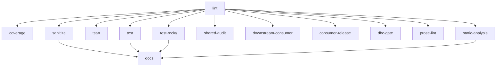
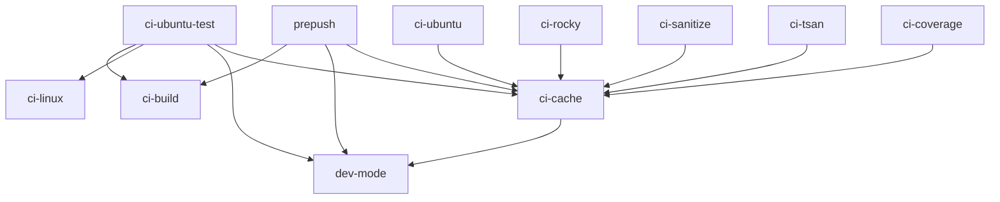
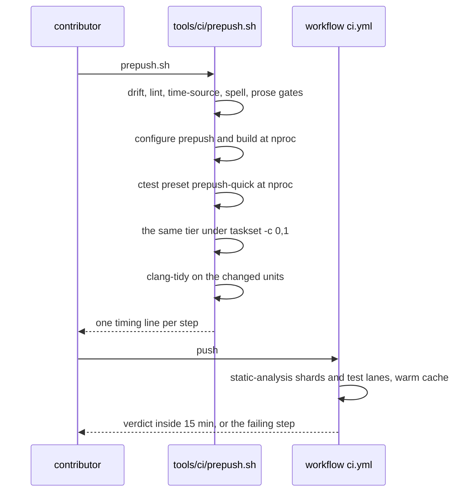

# Implementation Plan: CI Speed-Up

**Branch**: `030-ci-speedup` | **Date**: 2026-10-25 |
**Spec**: [specs/030-ci-speedup/spec.md](./spec.md)

**Note**: The `dev` presets are machine-local and absent from a fresh
clone, so every command here and in [quickstart.md](./quickstart.md)
names a checked-in preset. The base is `f507b8f`, the pre-030 master fix.

**Execution mode**: split by artifact. The two new `ctest` entries and
the `tools/dbc/coverage_gate.sh` change follow Principle III red-first:
each is written, seen failing, then made green. The workflow, preset and
registration edits are build configuration, so their evidence is a CI run
of the branch read with `gh`, with a local mirror ahead of the push. No
behavioral C++ code changes, so no new library test joins the suite
beyond the two entries FR-026 and FR-031 need.

## Summary

CI spends 2277 s of a 2621 s job compiling two translation units at a
time on a four-vCPU runner, with the analyzers inside the test build and
nothing reused between runs. This change moves the analyzers into a
sharded `static-analysis` job, gives every build and test step the
runner's cpu count, puts `ccache` behind the CI presets with a key that
names the compiler, the preset and the job, splits the semantics matrix
into five `ctest` entries that run on the three lanes with distinct
compilers, labels every test `quick` or `slow` from one list and adds
`tools/ci/prepush.sh` for the local 5-minute check, sets a 300 s budget
on every entry that holds none, caches the toolchain package lists,
cancels a superseded pull-request run, and makes `docs` wait for the
analyzers. No gate moves: the job set only grows by
`static-analysis`, no test is skipped, coverage keeps its bar and its
filters, both analyzers keep their unit set, and the coverage lane keeps
its instrumented suite separated because the `gcda` merge has no lock.

## Technical Context

| Item | Value |
| --- | --- |
| Language | C++23; no source file changes, so the standard is context here |
| Build | CMake presets in `CMakePresets.json`: `ci-ubuntu` inherits `ci-build`, `ci-linux`, `clang-tidy`, `cppcheck`, `dev-mode`; `ci-rocky` inherits `ci-build`, `ci-linux`, `dev-mode`; `ci-coverage`, `ci-sanitize`, `ci-tsan` are the lane presets |
| New presets | configure `ci-cache` (abstract), `ci-ubuntu-test`, `prepush`; test `prepush-quick`, `prepush-full`; no build preset is added |
| Workflow | `.github/workflows/ci.yml`, 803 lines, twelve jobs (`lint` 13, `coverage` 44, `sanitize` 91, `tsan` 125, `test` 155, `test-rocky` 224, `shared-audit` 251, `downstream-consumer` 348, `consumer-release` 495, `dbc-gate` 675, `prose-lint` 704, `docs` 757), twenty `-j 2` sites, no `concurrency` key |
| Test registration | `test/CMakeLists.txt`, 1505 lines, 133 `add_test` calls, 20 `set_tests_properties` calls, the `RESOURCE_LOCK` precedent at `:297`, `PROCESSORS 2` at `:660`, the matrix entry at `:139`, `add_folders(Test)` at `:1505`; `example/CMakeLists.txt`, 79 lines |
| Matrix script | `tools/dbc/semantics_matrix.sh`, 362 lines; `run_cell name ndebug opt contracts expect build_dbc` at `:154`; the four cells at `:323` to `:326` and the probe at `:330` |
| Analyzers | clang-tidy with `WarningsAsErrors: 'readability-identifier-naming'` at `.clang-tidy:21`; cppcheck with no `--error-exitcode`; both launchers cleared for a vendored tree at `CMakeLists.txt:145` to `:146` and `:663` to `:664` |
| Coverage | `cmake/coverage.cmake` capture with `--ignore-errors mismatch,negative,inconsistent` at `:57` to `:66`; extract filter `exception,branch,brace`; gate `tools/dbc/coverage_gate.sh` |
| Cache | none at the base: no `ccache`, no `sccache`, no `actions/cache` in `ci.yml` |
| Docs gates | `tools/docs/example_drift.py` with `PAGE_LINE_CAP = 835` at `:192`, `README.md` at 834 lines, `SECTIONS` of 27 H3 titles under `How you do it` |
| Formatter | clang-format 18.1.8 in CI and on the lane host |
| Platform | Linux only: `ubuntu-26.04` hosted runners, 4 vCPUs for a public repository, and a rocky container for `test-rocky` |

## Constitution Check

*GATE: Must pass before Phase 0 research. Re-check after Phase 1 design.*

| Principle | Result | Evidence |
| --- | --- | --- |
| I, standard-first P0 to P3 | PASS | the change adds no dependency; `ccache`, `actions/cache` and the five matrix entries are build and workflow configuration, and P0 standard facilities still answer every library question |
| II, Design by Contract | PASS | no public declaration changes; the two new `ctest` entries assert their own invariants over `ctest -N` output, and `tools/dbc/coverage_gate.sh` keeps a precondition and two distinct exits (FR-043) |
| III, R-DCUT | PASS | the spec carries FR-001 to FR-065 and SC-001 to SC-012; `test_tier_labels` and the budget audit are written red first; every contract file names the ids it closes |
| IV.1, main-page obligations | YES impact | one README block names both tiers and `tools/ci/prepush.sh` in 25 lines or fewer (FR-050, SC-010); no snippet region moves, so no `example/` file changes and no `SECTIONS` entry is added |
| V, style and naming | PASS | new CMake values `SPEEDGUN_DBC_MATRIX` and `SPEEDGUN_TEST_JOBS` are upper-snake, the new presets follow the file's `ci-*` and `prepush*` shapes, and the one formatting-only commit stays alone (FR-065) |
| VI, coverage | PASS with the base record | the bar, the `brace` filter and the ignore classes stay (FR-040, FR-041); the branch must reproduce the base reading of 99.4% lines and 97.5% branches and add no shortfall (SC-003), and the 100% bar closes in spec 032. The gate measures library sources and no library source changes. The two new shell files carry their own tests: `test_tier_labels` is seen failing before the label and budget blocks land and audits the determinism rules, and `tools/ci/prepush.sh` carries a `--self-check` mode that drives its own fault paths (FR-026, FR-030, FR-048) |
| VII, performance discipline | PASS | no per-iteration path is touched; `test/loop_shape.sh` and `test/cli_shape.sh` keep their base readings because no source file changes |
| VIII, hard CI gates | PASS with one addition | FR-045 keeps all twelve master jobs and adds `static-analysis`; the plan schedules every gate in the Implementation Strategy; `lint` is red at the base and the formatting-only commit clears it (FR-065). VIII names two sites where an analyzer finding shows up: the `test` job's build log and a contributor's local build. FR-015 moves the CI reading to `static-analysis`, FR-013 keeps `ci-ubuntu` carrying both launchers for the local build, and FR-050 names the local command on the main page. The gate set is untouched and the movement is written down here and in the pull request, because VIII forbids a silent change (FR-016, FR-018) |
| IX, spec-driven development | PASS | build configuration changes, so the full workflow applies; this artifact set is the plan phase |
| X.1, assumptions surfaced | PASS | the four assumptions the branch must measure are named in the Implementation Strategy: the runner cpu count, the `gcda` merge, the cache budget sum, and the analyzer unit set after the split |
| X.3, surgical change | PASS with one addition | the diff touches `.github/workflows/ci.yml`, `CMakePresets.json`, `test/CMakeLists.txt`, `example/CMakeLists.txt`, `test/tier_labels.sh`, `tools/ci/prepush.sh`, `tools/dbc/semantics_matrix.sh`, `tools/dbc/coverage_gate.sh`, `README.md`, the `PAGE_LINE_CAP` constant in `tools/docs/example_drift.py`, and the single formatting-only pass over `test/source/harness_cli_table_test.cpp` that FR-065 asks for; the constant is in because FR-050 lengthens the page and the drift gate holds the cap (P-09). The readings FR-051 to FR-056 demand are written to `specs/030-ci-speedup/results/`, one short record per reading, and those records are repository files the prose and spell gates read |
| X.4, verifiable success | PASS | SC-001 to SC-012 are read from `gh`, from `ctest -N`, from the coverage artifact and from a timed script run; [quickstart.md](./quickstart.md) runs each reading |
| XI, prose law | PASS | these artifacts pass `tools/prose/prose_gate.py` with zero findings and `codespell` with none |

**Post-Phase-1 re-check**: no gate fails on the design. Two numbers move
and both are recorded rather than silent: `PAGE_LINE_CAP` moves to the
measured page length with the file's own comment form (P-09), and the
`docs` job gains one `needs` entry (FR-038). `VERSION 0.20.0` and both
`SOVERSION` values stay (FR-058, SC-009), because no library surface
changes. No contract adds an option, an environment variable or a schema
key (FR-057).

## Project Structure

### Documentation (this feature)

```text
specs/030-ci-speedup/
├── spec.md                          FR-001 to FR-065, SC-001 to SC-012, PC-1 to PC-10
├── plan.md                          this file
├── research.md                      plan decisions P-01 to P-13
├── data-model.md                    records E-01 to E-10 with their fields and invariants
├── quickstart.md                    the local run, the two tiers, the gate readings
├── checklists/requirements.md       requirements quality checklist, closed
└── contracts/
    ├── job-graph.md                 job set, needs, concurrency, step shape
    ├── presets.md                   preset graph and cache variables
    ├── test-registration.md         labels, PROCESSORS, RESOURCE_LOCK, TIMEOUT
    ├── prepush-script.md            options, steps, output lines, exit codes
    └── coverage-invariant.md        trace equality, gate exits, lane separation
```

`tasks.md` is `/speckit.tasks` output and does not exist yet.

### Source and configuration (repository root)

| Path | Change | Carried by |
| --- | --- | --- |
| `.github/workflows/ci.yml` | cpu-count parallelism at twenty sites, `ccache` install and cache steps, the sharded `static-analysis` job, `ci-ubuntu-test` for `test`, package caches, `concurrency`, `docs` needs, per-test budget reads | FR-001, FR-002, FR-006 to FR-009, FR-014, FR-015, FR-018, FR-035 to FR-039 |
| `CMakePresets.json` | configure `ci-cache`, `ci-ubuntu-test` and `prepush`, test `prepush-quick` and `prepush-full`, the launcher cache variables in one inherited preset, the lane switch for the matrix | FR-006 to FR-013, FR-023, FR-028 |
| `test/CMakeLists.txt` | five matrix entries, the tier list and its loop, the budget loop, the `PROCESSORS` and `RESOURCE_LOCK` values, `test_tier_labels` | FR-003, FR-004, FR-019 to FR-023, FR-025, FR-026, FR-031 |
| `example/CMakeLists.txt` | the budget loop over its two entries | FR-031 |
| `tools/dbc/semantics_matrix.sh` | one cell per invocation, `JOBS` from an environment value, probe sources written once per entry | FR-020, FR-022 |
| `tools/dbc/coverage_gate.sh` | one exit for a refused trace and a separate exit for a shortfall | FR-043 |
| `tools/ci/prepush.sh` | new: the local two-tier check with per-step timing | FR-029, FR-030 |
| `README.md` | one block in `Quick start` naming both tiers and the script | FR-050 |
| `tools/docs/example_drift.py` | `PAGE_LINE_CAP` moves to the measured page length | P-09 |
| `test/source/harness_cli_table_test.cpp` | formatting only, in its own commit | FR-065 |

No file under `include/` or `source/` changes.

## Design: job graph and preset graph

The job graph the workflow carries after the change, `needs` edges only.
The base holds ten jobs on `needs: [lint]` at `ci.yml:45`, `:92`, `:126`,
`:156`, `:225`, `:252`, `:349`, `:496`, `:676`, `:705`, and `docs` on
`needs: [sanitize, test, test-rocky]` at `:759`:



`static-analysis` is new, carries `needs: [lint]` beside the ten, and
configures `ci-ubuntu`, so the units it analyzes are the units the `test`
job used to compile with the analyzers attached. `test` configures
`ci-ubuntu-test`, which holds no analyzer. No other edge moves, and no
edge is removed (FR-038, FR-045).

The preset graph the change adds, `A --> B` meaning `A` inherits `B`:



`ci-cache` is a new abstract preset that carries only the two launcher
cache variables (P-02). It is inherited by every preset that builds, the
local `prepush` preset included, because FR-006 and FR-028 both name the
launcher. A lane host keeps its own `CCACHE_DIR` outside the workspace,
so no `actions/cache` key is involved there (P-06, P-10).

The two-tier flow, one contributor's loop:



## Design: Physical View

| Artifact | Duty |
| --- | --- |
| `.github/workflows/ci.yml` | the job graph, the cache steps, the shard lists, the measurement steps that print `ccache -s` and each install step time |
| `CMakePresets.json` | the preset graph: who carries the analyzers, who carries the launcher, which lane registers the matrix |
| `test/CMakeLists.txt` | one list that gives every entry its tier label, its budget, its `PROCESSORS` and its `RESOURCE_LOCK`, plus the five matrix entries |
| `tools/dbc/semantics_matrix.sh` | one cell per run, so one `ctest` entry names one cell |
| `tools/dbc/coverage_gate.sh` | the two distinct exits the coverage lane needs |
| `tools/ci/prepush.sh` | the local mirror of the CI checks, with a printed time per step |
| `README.md`, `tools/docs/example_drift.py` | the docs obligation and the page cap that moves with it |

## Sources & References

- Spec: [specs/030-ci-speedup/spec.md](./spec.md), its decisions D-1 to
  D-13, its preconditions PC-1 to PC-10 and its clarification session of
  2026-10-25.
- Constitution: [.specify/memory/constitution.md](../../.specify/memory/constitution.md),
  Principles II, III, IV.1, V, VI, VII, VIII, IX, X and XI.
- Neighbor artifact: [026 plan](../026-regression-gate/plan.md) for the
  docs-cap comment form and the gate schedule.
- Code anchors, re-read at the base `f507b8f` on 2026-10-25:
  `.github/workflows/ci.yml:13`, `:44`, `:71`, `:91`, `:123`, `:125`,
  `:153`, `:155`, `:222`, `:224`, `:249`, `:251`, `:348`, `:495`, `:675`,
  `:696`, `:704`, `:754`, `:757`, `:759`; `CMakePresets.json` preset
  list and inheritance as tabulated above; `CMakeLists.txt:15`, `:63`,
  `:145` to `:146`, `:281`, `:663` to `:664`;
  `test/CMakeLists.txt:139`, `:297`, `:580`, `:660`, `:742`, `:1392`,
  `:1408`, `:1425`, `:1440`, `:1456`, `:1473`, `:1487`, `:1505`;
  `tools/dbc/semantics_matrix.sh:54`, `:60`, `:76`, `:154`, `:181`,
  `:182`, `:186`, `:228`, `:323` to `:326`, `:330`;
  `cmake/coverage.cmake:57` to `:66`; `tools/docs/example_drift.py:192`;
  `.clang-tidy:21`; `cmake/lint.cmake:51`; `cmake/folders.cmake` and its
  three `add_folders` callers; `README.md` at 834 lines.
- Measurement anchors, read with `gh` on 2026-10-25: run 39708015373 for
  the base table, 40042928839 (`fea69c5`) for the re-measured baseline of
  section B of the spec, 39941934864 (`d6d60f2`) for the two other base
  reds, 40203022166 (`f507b8f`) for the eleven skipped jobs.

## Phase 0: Design Decisions

Thirteen decisions stand in [research.md](./research.md) with their
rationales and rejected alternatives. Plan decisions are numbered `P-nn`
so a bare `D-n` always names the spec's own decision:

- P-01: the matrix lanes are chosen by the cache variable
  `SPEEDGUN_DBC_MATRIX` set in the three registering presets.
- P-02: a new abstract preset `ci-cache` carries the two launcher
  variables, and every CI configure preset inherits it once.
- P-03: `tools/dbc/semantics_matrix.sh` takes the cell name as an
  argument and writes its own probe source once per entry.
- P-04: the five entries are named for their cells and take `JOBS` from
  `SPEEDGUN_TEST_JOBS`.
- P-05: the tier labels come from one `SPEEDGUN_SLOW_TESTS` list with a
  reason comment per row, and a trailing loop labels the rest `quick`.
- P-06: `prepush` presets hold no `binaryDir` under `build`, so a lane
  host build stays out of the CI tree.
- P-07: the budget loop reads the directory `TESTS` property and sets
  `TIMEOUT 300` where no `TIMEOUT` stands.
- P-08: `static-analysis` shards by build scope: the two library
  targets, the `test` directory, and the `example` directory. It carries
  `needs: [lint]` beside the ten jobs that already do.
- P-09: the README block lands inside `Quick start` as a marked region of
  `example/quickstart.sh`, and `PAGE_LINE_CAP` moves to the measured page.
- P-10: the cache key of D-9 is built from `gh` context values in one
  `env` block, and `CCACHE_DIR` sits under the workspace.
- P-11: the coverage lane runs `-j 1` first, and a `RESOURCE_LOCK` over
  the exec-child entries is the measured alternative.
- P-12: `coverage_gate.sh` separates a refused trace from a shortfall by
  reading lcov's own report lines.
- P-13: the collision audit that FR-004 needs is a named list of shared
  resources read from the registrations.

## Phase 1: Data Model & Contracts

Records E-01 to E-10 with their fields, invariants and the requirement
that governs each stand in [data-model.md](./data-model.md). Contracts,
one file per observable surface this change owns:

| Contract | Surface | Closes |
| --- | --- | --- |
| [contracts/job-graph.md](./contracts/job-graph.md) | job set, `needs`, `concurrency`, step names, install-step timing | FR-014, FR-015, FR-016, FR-035 to FR-039, FR-045 to FR-047 |
| [contracts/presets.md](./contracts/presets.md) | preset names, inheritance, launcher variables, lane selection | FR-006 to FR-013, FR-023, FR-028 |
| [contracts/test-registration.md](./contracts/test-registration.md) | tier labels, `PROCESSORS`, `RESOURCE_LOCK`, budgets, the matrix entries | FR-001 to FR-005, FR-019 to FR-027, FR-031 to FR-034, FR-048 |
| [contracts/prepush-script.md](./contracts/prepush-script.md) | options, step order, timing lines, exit codes, the formatter check | FR-029, FR-030, FR-050 |
| [contracts/coverage-invariant.md](./contracts/coverage-invariant.md) | trace equality, gate exits, lane separation, the forbidden list | FR-040 to FR-044, FR-049 |

The measurement obligations FR-051 to FR-056 are the pull request's own
report, carried in [quickstart.md](./quickstart.md) as the readings that
produce each table. The scope, version and history obligations FR-057 to
FR-065 are carried by the commit and push rules in the Implementation
Strategy.

## Task Planning Summary

`tasks.md` lands when `/speckit.tasks` runs. The phases and counts this
plan commits to:

| Phase (the numbers match tasks.md) | Tasks |
| --- | --- |
| 1 Setup: the formatting-only commit FR-065, the abstract `ci-cache` preset, the `tools/ci/prepush.sh` scaffold, the results ledger convention | 4 |
| 2 Foundation: the `ci-ubuntu-test` and `prepush` presets, cpu-count parallelism at twenty sites, the collision audit and the `RESOURCE_LOCK` and `PROCESSORS` values, the budget loop, the tier list with `test_tier_labels` written red first | 8 |
| 3 US1: `ccache` install and cache steps, the key of D-9, hit-rate printing, cold and warm runs | 7 |
| 4 US2: `tools/ci/prepush.sh` steps, timing lines, option faults, the formatter version stop | 6 |
| 5 US3: the `static-analysis` job, its three shards, the finding-list artifacts, the planted-violation throwaway branch | 6 |
| 6 US4: five matrix entries, the cell argument in the script, lane selection, the three compiler records | 7 |
| 7 US5: label partition proof, the no-filter rule in every CI `ctest` line, the README block and the page cap | 5 |
| 8 US6: budgets, the exceptions list with measured numbers, the per-entry audit | 4 |
| 9 US7: dnf keepcache and apt archive caches, the minimal bootstrap install, install-step timing | 4 |
| 10 US8: `concurrency` key, the two-push and master-push readings | 2 |
| 11 Polish: the coverage gate exits, the coverage lane separation, `docs` needs, the measurement tables and the pull-request report, the full gate run | 8 |

Sixty-one tasks, `T001` to `T061`.

## Implementation Strategy

Order, with the reason each step sits where it does:

1. The formatting-only commit first, alone. `lint` gates the graph, so
   nothing else can be measured until it passes (FR-065).
2. Presets next, because every workflow edit names a preset. `ci-ubuntu`
   stays as master has it (FR-013, D-3). The preset work and the
   parallelism edit share a wave, because one writes
   `CMakePresets.json` and the other writes
   `.github/workflows/ci.yml`.
3. Parallelism and the collision audit together. Raising `-j` without
   the audit is how a shared file becomes a flake: `harness_cli_test`
   already writes `harness_cli_column_note.txt` into its working
   directory, so it needs a `RESOURCE_LOCK` or a per-entry directory
   before `-j "$(nproc)"` reaches it (FR-004, FR-005).
4. Tier labels and the budget loop, with `test_tier_labels` seen failing
   first. The label loop and the budget loop share one trailing block
   that reads the directory `TESTS` property (P-05, P-07).
5. `ccache`, then the local script, because the 5-minute number needs a
   warm cache to be meaningful.
6. The analyzer split, then the matrix split, then the package caches,
   then `concurrency` and `docs` needs.
7. The measurements and the pull-request tables last, from the last run
   of the branch (FR-051 to FR-056).

Gates, all scheduled, none weakened: `cmake --preset=ci-rocky` and
`cmake --build build` with `ctest --test-dir build --output-on-failure`,
then `ci-ubuntu` with clang-tidy and cppcheck, `ci-sanitize`, `ci-tsan`,
the coverage target driven by `tools/dbc/coverage_gate.sh` at the base
reading with no new `LCOV_EXCL` marker,
`cmake -D FORMAT_COMMAND=clang-format -P cmake/lint.cmake`,
`cmake -P cmake/spell.cmake`, `cmake -P cmake/prose-lint.cmake`,
`python3 tools/docs/example_drift.py .`, `bash test/time_source_gate.sh .`,
`ctest --test-dir build -R 'loop_shape|cli_shape'`, and the DBC gates.

Measurement duties the branch settles by reading a log or an artifact:

- Runner cpus: FR-001's `-j $(nproc)` assumes 4 vCPUs on a public
  repository. The job log prints `nproc`, so the reading is recorded.
- The `gcda` merge: the coverage lane starts at `-j 1`. If the step time
  exceeds the base 334 s by more than the matrix saving, the
  `RESOURCE_LOCK` form replaces it (P-11, D-8). The `CCACHE_DISABLE=1`
  against warm equality of SC-003 is the measurement that settles it.
- The cache budget: `CCACHE_MAXSIZE` per lane, with the sizes summed in
  the pull request against the 10 GB repository budget.
- The analyzer unit set: the sharded job prints the count of analyzed
  units, and FR-049's finding-list equality is the guard.
- The matrix compiler proof: PC-6 is re-read from the configure logs of
  the branch before two lanes are allowed to drop the matrix (FR-023,
  FR-024).
- The wall median: three master pushes and three pull-request pushes of
  the branch are timed with a warm cache and the median is reported, each
  run with its install-step time, and a canceled run supplies no timing
  (FR-052, SC-002).
- The sanitizer repetitions: `sanitize` and `tsan` each run three times at
  the runner's full affinity and the three verdicts are compared, because
  one green run of a race-prone entry proves little (FR-055, SC-006).

Risks named early: the analyzer install step costs 991 s on one day and
32 s on another, so a cache-miss run must be timed before the saving is
claimed; a warm-cache run of a branch that adds a finding must still fail
`static-analysis`, which is why no analyzer result is cached (FR-017);
and the coverage lane's serialization is the one place where a speed-up
can cost time, so its step time is recorded beside the base number.

## Test Plan

- `test_tier_labels` (new, `ctest` entry): runs `ctest -N -L quick` and
  `ctest -N -L slow`, fails on an overlap, fails when the union leaves an
  entry of `ctest -N` unlabeled, and fails when an entry carries both
  labels. Written red first against an unlabeled suite.
- Budget audit, part of the same entry: reads `ctest -N` with
  `ctest --debug`-level properties or `ctest -N -V` output and fails when
  an entry holds no budget and no exception line.
- Matrix entries: five entries, each printing its cell name, its `JOBS`
  value and its compiler version, so the record FR-023 asks for lands in
  the job log.
- `coverage_gate.sh`: the refused-trace exit and the shortfall exit are
  separate, each reached by a fixture trace. No fixture fabricates a
  passing trace: the refused case is a real `lcov --summary` refusal.
- `tools/ci/prepush.sh`: the unknown-option exit 2, the formatter version
  stop before any format runs, the per-step timing line, and the `--full`
  step set. The script is shell, so these readings are driven by a small
  self-check inside the script plus the quickstart's manual run.
- Nothing sleeps, reads a clock for a verdict, retries, or skips
  (FR-048). Nothing pins prose text: the README block is checked by the
  drift gate; no test pins the text.
- CI evidence: SC-001 to SC-006 are read from runs with `gh`, per
  [quickstart.md](./quickstart.md). A canceled run is not used for a
  timing.
