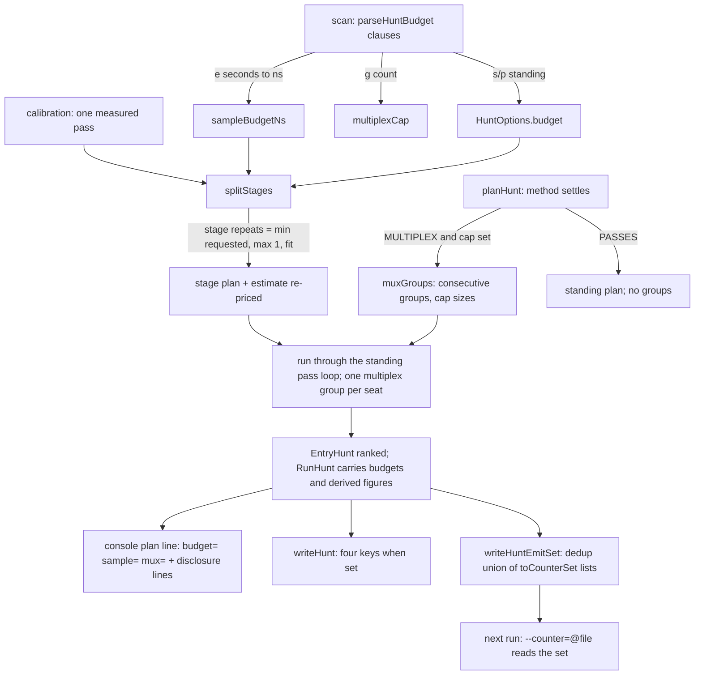

# Implementation Plan: Hunter Budgets and Promotion (N14a-2)

**Branch**: `033-hunter-budgets` | **Date**: 2026-10-28 | **Spec**: [spec.md](./spec.md)

**Input**: Feature specification from `specs/033-hunter-budgets/spec.md`

## Summary

The hunter's budget story closes and the ranked events gain a way
out. `--hunt-budget=` grows from one `<n>s`/`<n>p` text to one value
of comma clauses: `s` and `p` keep the two-stage meaning and integer
parse (spec 029 D-2 untouched), `e` names the sample budget in
seconds with fractions, `g` names the multiplex cap as a whole count
1 to 10000. The planner derives a stage's repeats from the
calibration figure it already takes as data (largest fit, floor one,
cap at the requested repeats) and caps each multiplex group at the
`g` count, splitting a capped `MULTIPLEX` plan into consecutive
groups in plan order; every derived figure discloses on the plan line
and in the JSON. `--hunt-emit-set=<file>` (option value 280) writes
the run's ranked addresses, and `--counter=@<file>` reads them again
under the spec 029 list-file rules. The library gains
`EntryHunt::toCounterSet(topN)`. The schema takes minor 1.7 with four
conditionally present `hunt` keys; the harness `SOVERSION` rises to
14 for the new public surface, the archive stays 4.

## Technical Context

**Language/Version**: C++23 (`cxx_std_23` on every target; the
constitution pins the language)

**Primary Dependencies**: the standing hunt tree (spec 029):
`include/speedgun-ng/hunt.hpp`, `source/harness/hunt_plan.cpp`
(`planHunt`, `splitStages`, `rankEvents`),
`source/harness/hunt.cpp` (`runHuntNamed`, the stage loop),
`source/harness/hunt_cli.cpp` (the eight parse arms,
`readSelectionFile`, the conflict check),
`source/harness/detail/hunt_selection.hpp` (shared selection rules),
`source/harness/options.cpp` (the one table, the `counter` gather arm
at `:1537`), `source/harness/report.cpp` (`printHuntPlan`),
`source/harness/json_report.cpp` (`writeHunt`), `source/harness/json_load.cpp`
(`readHunt`), `source/harness/cli.cpp` (conflict check `:524`, batch
loop `:1248`, `writeReport` call `:1536`); the scripted seam
`FakeProvider` and the scripted-host fixture
`test/source/detail/pass_fixture.hpp`; simdjson for JSON both ways.

**Storage**: N/A: no database. Two flat files join the run, both
one-address-per-line: the emitted counter set written by
`--hunt-emit-set`, read again by `--counter=@<file>`.

**Testing**: the repository harness (`add_executable` per area plus
`add_test`); extended `harness_hunt_cli_test`,
`harness_hunt_plan_test`, `harness_hunt_json_test`,
`harness_hunt_report_test`, green `harness_cli_table_test`; scripted
hosts through `FakeProvider`/`pass_fixture`; `ctest -j 2`; the suite
passes under `taskset -c 0,1`.

**Target Platform**: Linux only (`ci-ubuntu`, `ci-rocky`). The daily
loop drives `ci-rocky`; once per feature `ci-ubuntu` runs clang-tidy
and cppcheck. Acceptance stands on gary (Zen 5); no Intel run.

**Project Type**: library + CLI feature: one public method and two
public fields on the hunt surface, one option row, one value-grammar
extension; everything else harness-internal.

**Performance Goals**: the budgets are plan-side arithmetic over the
standing calibration figure; the run adds no timed column, no clock
read, no second pass loop. The emitted write is one file at the end
of the batch.

**Constraints**: 100% line and branch coverage with no `LCOV_EXCL`
marker and no new `--ignore-errors` entry; no sleep, no clock, no
fixed cpu or event numbers in a test; one line naming the value plus
exit 2 for every bad value; timing bounds sit an order of magnitude
inside the contamination signal the specs/032 record fixes; no
lambda inside an `SG_*` macro; simdjson only; counters-only (hard
rule 15); option value 280, no short letter, no environment source.

**Scale/Scope**: one option row; four clause kinds in one parse
function; one planner derivation and one group split; one file
writer; one gather-arm interception; two public fields and one
public method; four schema keys at minor 1.7; four extended test
executables; docs rows and one extended example.

**Execution mode**: TDD (Principle III). Every test task is written
and observed failing before the implementation that turns it green;
`plan.md` records the mode here.

## Constitution Check

*GATE: Must pass before Phase 0 research. Re-check after Phase 1
design.*

| Principle | Gate | Status |
| --- | --- | --- |
| I. Standard-first | C++23 only; no P0 critical-path claim (the planner runs once per stage, outside every timed window); standard parsing and file interfaces, no compiler extension | PASS |
| II. Design by contract | `toCounterSet` carries `\pre`/`\post` in the house form; `HuntOptions` fields keep the struct's invariant sentence; internal helpers carry `SG_REQUIRE`/`SG_ENSURE` one-for-one with doc lines (dbc-gate); contract refusals stay recoverable errors, the usage refusals stay the CLI's exit-2 route | PASS |
| III. R-DCUT | FR-001 to FR-045 map to the decisions R-01 to R-16 below and to `tasks.md`; TDD mode recorded above | PASS |
| IV. Documentation | README `Hunter mode` growth stays within `SECTION_LINE_CAP` (IV.1); `docs/pages/harness.md` carries the clause grammar, the option row and the four JSON fields; the example region and quick-reference rows move in the same change (FR-030, FR-031) | PASS |
| V. Style | new names follow V.1: `kHuntEmitSetOption`, `sampleBudgetNs`, `multiplexCap`, `muxGroups`, `readAddressFileLines`, lower_case files; clang-format at the feature head | PASS |
| VI. Coverage | every clause kind, refusal, derived-repeat branch, group-split size, emit composition case and JSON presence branch runs under scripted data; 100% line and branch, no exclusion (FR-041) | PASS |
| VII. Performance | the derivation is integer arithmetic on data the plan already holds; the group split is one linear pass over the planned addresses; no benchmark baseline is claimed | PASS |
| VIII. CI gates | format, spell, tidy, cppcheck, sanitizers, tsan, coverage, docs gates (drift, snippet compile, example run, report shape), prose, DBC, time-source, name-check all run at the feature head | PASS |
| IX. Spec-driven | spec, plan, research, data-model and contracts stand in `specs/033-hunter-budgets/`; `tasks.md` lands with `/speckit.tasks` before code | PASS |
| X. Anti-slop | one parse function extended in place; one shared list-file reader (R-09); no new seam beyond the scripted host the tests already install; two fields join `HuntOptions` because the disclosure must round-trip (X.1: an options struct, never a bool, hard rule 8) | PASS |
| XI. Prose | every artifact and commit line follows XI; `prose-lint` runs over the added lines | PASS |

No gate opens a Complexity Tracking row.

## Project Structure

### Documentation (this feature)

```text
specs/033-hunter-budgets/
├── spec.md
├── plan.md              # this file
├── research.md          # Phase 0
├── data-model.md        # Phase 1
├── quickstart.md        # Phase 1
├── checklists/requirements.md
├── contracts/
│   ├── budget-grammar.md   # the --hunt-budget= clause grammar
│   ├── counter-file.md     # --hunt-emit-set file, --counter=@<file>
│   └── hunt-json.md        # the four new hunt keys at schema 1.7
└── results/               # the gary acceptance record (FR-045, at
    │                      # implement time)
```

### Source (this feature)

```text
include/speedgun-ng/
└── hunt.hpp                  + HuntOptions::sampleBudgetNs,
                                HuntOptions::multiplexCap,
                                EntryHunt::toCounterSet(topN)

source/harness/
├── detail/options.hpp        + kHuntEmitSetOption = 280; block
│                               comment moves (281 to 289 stay free)
├── detail/internal.hpp       + RunOptions::huntEmitSet path member
├── detail/hunt_selection.hpp + readAddressFileLines (the shared
│                               one-level list-file reader)
├── hunt_selection.cpp         + the reader body (the harness
│                               GLOB_RECURSE picks the TU up)
├── detail/hunt_plan.hpp      + MuxGroup table type; derived-repeat
│                               and split declarations (internal)
├── hunt_plan.cpp             parse-free planner: derived repeats in
│                               splitStages, muxGroups in planHunt
├── hunt.cpp                  runHuntNamed: one multiplex group per
│                               seat through the standing loop;
│                               RunHunt carries the new figures
├── hunt_cli.cpp              parseHuntBudget clause loop;
│                               parseHuntEmitSet; writeHuntEmitSet;
│                               readSelectionFile delegates to the
│                               shared reader
├── options.cpp               + {"hunt-emit-set"} row and case arm;
│                               case 'c' intercepts the '@' form
├── cli.cpp                   conflict check grows the emit row;
│                               emit write after the batch beside
│                               the writeReport call; status wiring
├── report.cpp                plan line grows sample=/mux= segments
│                               and the two disclosure lines
├── json_report.cpp           writeHunt appends the four keys when set
└── json_load.cpp             readHunt reads the four keys as absent-
                                by-default; two text readers (e, g)

docs/schema/report-v1.json    + sample_budget, multiplex_cap,
                                derived_repeats, mux_groups;
                                x-order moves in the same commit
README.md                     Hunter mode growth (≤ 25-line section)
docs/pages/harness.md         clause grammar, option row, field rows
example/docs/hunt_rank.cpp    extended to print a promoted set from a
                              scripted ranked record; .expected re-recorded
test/source/
├── harness_hunt_cli_test.cpp     grammar, refusals, emit file, the
│                                 counter @-form, the round trip
├── harness_hunt_plan_test.cpp    derived repeats, group split,
│                                 composition with the two-stage plan
├── harness_hunt_json_test.cpp    the four keys, absence, refusals,
│                                 pre-1.7 documents
├── harness_hunt_report_test.cpp  plan line and disclosure lines
└── harness_cli_table_test.cpp    green unchanged (uniqueness holds)
```

**Structure Decision**: the standing hunt tree absorbs everything;
no new target, no new file outside `specs/`. The one moved piece is
`readSelectionFile`, which becomes the shared
`detail::readAddressFileLines` so the `--counter=@` arm and the hunt
selection read one grammar from one place.

## Design

### Decision index

- **R-01 The clause grammar (FR-004).** `parseHuntBudget` splits the
  value on `,` and reads one clause per part: digits, optional `.`,
  digits, then one suffix of `s`, `p`, `e`, `g`. `s`/`p` keep the
  standing whole-count rule (P-1). `e` reads finite seconds above
  zero through the `parseSeconds` shape: fraction allowed, nothing
  below one nanosecond, at most `kMaxWholeSeconds`, kept as whole
  nanoseconds in `HuntOptions::sampleBudgetNs`. `g` reads a whole
  count 1 to 10000 into `HuntOptions::multiplexCap`. Refusals, each
  one line quoting the whole value, exit 2: empty value, empty
  clause, repeated kind, missing suffix, non-numeric text, out of
  range, leading or trailing blank. A value with one `s` or `p`
  clause parses exactly as before. (contracts/budget-grammar.md)
- **R-02 Derived repeats (FR-001, FR-002).** In `splitStages`, when
  `sampleBudgetNs` and the calibration figure stand, the stage repeat
  count becomes `min(requested, max(1, sampleBudgetNs /
  (calibrationNsPerPass × passesOfStage)))`; the per-repeat,
  per-stage figure is the standing `calibrationNsPerPass × passes`
  product the estimate already computes (`hunt_plan.cpp:204`). No
  clock read; pure data. The derived count re-prices `estimateNs`
  and feeds the standing stage-drop decision (FR-005).
- **R-03 Overrun and unpriced (FR-002).** One repeat above the
  budget keeps one repeat and records the overrun on the plan record;
  no calibration figure keeps the requested count and records the
  unpriced state. The record carries the state as data; the printers
  spell it; the run never refuses for it.
- **R-04 The multiplex group split (FR-003).** After the method
  settles, when `multiplexCap` stands and the method is `MULTIPLEX`,
  `planHunt` records `muxGroups`: the planned addresses split into
  consecutive groups of at most the cap in plan order (200 with 32
  gives 32×6 then 8). A `PASSES` plan records no groups; the cap
  binds nothing. The run seats one group per multiplex pass through
  the standing pass loop (`hunt.cpp:collectStageSamples`); no second
  loop, no second counter path (D-23 of spec 029 stands).
- **R-05 Composition (FR-004, FR-005).** The three budgets coexist:
  the two-stage split chooses its stages, the sample budget derives
  the repeats inside each chosen stage, the cap groups inside each
  stage's plan; the stage-drop reason reads the re-priced figures.
  Clause kinds compose freely; none rewrites another's rule.
- **R-06 The public record (FR-013).** `HuntOptions` gains
  `std::optional<std::uint64_t> sampleBudgetNs` and
  `std::optional<std::size_t> multiplexCap`; `RunHunt` and
  `EntryHunt` need no new data for the budgets (the run record owns
  `options`). `EntryHunt::toCounterSet(std::size_t topN)` answers a
  `std::vector<std::string>`: ranked entries with a rank, ascending
  rank, capped at `topN`, one address each. It measures nothing and
  reads no clock (the header's standing sentence extends).
- **R-07 The emitted file (FR-011).** `writeHuntEmitSet` (beside the
  reader in `hunt_cli.cpp`) walks the report's entries in run order;
  per entry it takes `toCounterSet(options.top)`; it writes the
  deduplicated union, one address per line, no header. A run that
  ranks nothing writes an empty file. It joins cli.cpp after the
  batch, beside the `writeReport` call, guarded by the settled
  `huntEmitSet` path.
- **R-08 Emit refusals (FR-012).** The conflict check
  (`cli.cpp:524`) grows: an emit path with no hunt (including
  `--hunt=none`) leaves one line naming the value with exit 2. An
  unwritable destination prints the standing report-file sentence
  (`json_report.cpp:1042` shape: path, reason from `errno`) and sets
  status 2 exactly as the report failure does (`cli.cpp:1540`).
- **R-09 The counter `@`-form (FR-014).** The list-file reader moves
  from `hunt_cli.cpp` to
  `detail::readAddressFileLines(path, refusalContext)`; the hunt
  selection delegates, keeping its own refusal sentences. The
  `counter` gather arm (`options.cpp:1537`) intercepts a value that
  starts with `@` before `sourceItems`: one level, the lines are the
  addresses, `#` starts a comment, blank lines are skipped; a
  missing file, an empty address line, and a file holding no address
  each refuse through the arm's standing `refuse` route (one line,
  exit 2). Unknown addresses keep the standing `ABSENT` column shape
  (`runner.cpp:1239` onward, unchanged). No count cap joins. The
  interception sits in the gather arm, so command line, option file
  and environment carry one grammar.
- **R-10 Console disclosure (FR-023).** `printHuntPlan` grows two
  conditional segments after the standing `budget=`: `sample=<text>`
  and `mux=<text>`, each the canonical clause text rebuilt from the
  stored value (`e` rebuilds minimal decimal seconds; `g` the whole
  count). Two conditional lines follow, in the standing `hunt: plan`
  style: `hunt: plan sample repeats=<d> of <m>` (derived, shown when
  the count moved; `=1 over-budget` on the overrun; `unpriced`
  instead when no figure priced it) and `hunt: plan mux groups=<n>`
  with the sizes spelled after it. An unset budget prints nothing:
  a run without the budgets prints the standing bytes (FR-022).
- **R-11 The JSON keys (FR-020, FR-022).** `writeHunt` appends,
  after `stage_two_events`, in x-order: `sample_budget` (the `e`
  clause text), `multiplex_cap` (the `g` clause text),
  `derived_repeats` (integer), `mux_groups` (array of integers).
  Each key is written only when its budget stands: an unset run
  writes the standing bytes (the byte rule of FR-022 needs
  conditional presence: the key is absent when unset). `docs/schema/report-v1.json`
  gains the four properties and the moved `x-order` in the same
  commit; `required` keeps the standing sixteen (a pre-1.7 hunt
  document must stay valid and loadable).
- **R-12 The JSON reader (FR-021).** `readHunt` extends the key list
  and the `at` indexes; the four new keys read as absent-by-default:
  missing stands unset, present must match the kind. The `e` reader
  reuses the `asBudget` refusal shape with the `e` suffix (one test
  per refused code); the `g` reader keeps the whole-count shape.
  Round-trip equality is FR-021's test.
- **R-13 The option row (FR-010).** One table row
  `{"hunt-emit-set", kHuntEmitSetOption, REQUIRED, false, help,
  "specs/033"}`; `kHuntEmitSetOption = 280` beside the hunt
  constants; `options.hpp` block comment moves (281 to 289 stay
  free); the parse arm stores the path in `RunOptions::huntEmitSet`
  and refuses the empty value in the standing one-line shape.
- **R-14 The example (FR-031).** `example/docs/hunt_rank.cpp` gains
  the promotion inside its scripted shape: a ranked record built
  through the pure `rankEvents` over scripted samples answers
  `toCounterSet`, the program prints the promoted addresses, and the
  result sentence names the `--counter=@<file>` reading they serve.
  The `.expected` re-records; the example stays host-independent.
- **R-15 Schema, version, ABI (FR-040).** Schema `1.7`; version the
  next free minor at the version-move commit (`0.22.0` while nothing
  else moves); harness `SOVERSION` 13 to 14 (new public method and
  fields); archive `SOVERSION` stays 4 (no counters-library surface
  moves; the scripted seam grows no new API; the check stands
  recorded in the version-move commit).
- **R-16 Evidence (FR-045).** `specs/033-hunter-budgets/results/`
  carries the gary table (scenario, command, exit, observation) for
  the budgeted `--hunt=all` run and the read-back; the record states
  the standing no-Intel fact.

### Risks

- The multiplex group loop touches the seat shape of
  `collectStageSamples`; a wrong seat split shows as a group-open
  failure the standing D-18 retry would mask. Mitigation: the plan
  test asserts the group table before the run test asserts the
  seats, and the scripted host answers per-group open refusals
  through the 029 open-failure seam.
- Conditional JSON presence differs from the standing
  `budget`-null habit; a reader written for null-presence would miss
  the rule. Mitigation: `contracts/hunt-json.md` states presence
  per state, and `harness_hunt_json_test` pins both documents.
- The `@` interception in the gather arm runs before the scan
  settles the row; a later source could settle a different value.
  The standing whole-row replacement already answers this: the
  winning source's file is the one read; the losing source's read
  failure stands as its own usage error, matching the standing
  percentile-list refusal shape.
- Fractional `e` text must rebuild canonically for the JSON round
  trip (`0.50e` must not round-trip as `0.5e` unequal). Mitigation:
  the writer rebuilds from whole nanoseconds (the standing
  amount+kind rebuild of `budget`), and the round-trip test carries
  a fraction and a whole second.

### Logical view: what decides, and when



State: a budget stands in one of {unset, priced-and-fit,
priced-and-clamped-at-one (overrun), unpriced}; the record names the
state; the printers and the JSON spell exactly what the record
holds.

### Physical view

Library `speedgun-ng::harness` (shared, `SOVERSION 14`) carries the
hunt surface (`hunt.hpp` public), the planner (`hunt_plan.cpp`), the
run (`hunt.cpp`), the option arms (`hunt_cli.cpp`,
`options.cpp`) and the printers (`report.cpp`,
`json_report.cpp`/`json_load.cpp`); the counters archive
(`SOVERSION 4`) is untouched. No new target; no new link edge.
Public symbols added: `toCounterSet`, the two `HuntOptions` fields
(record layout).

### Version and `SOVERSION`

Version `0.22.0` (next free minor at the move commit); harness
`SOVERSION` 13 → 14; archive `SOVERSION` stays `4` (check recorded
beside the move, FR-040); report schema `1.6` → `1.7` with the
`x-order` commit rule (FR-020).

## Test Plan

TDD: each numbered row lands as a failing test first, then the code
that turns it green.

1. Grammar (`harness_hunt_cli_test`): every clause kind, every
   refusal of contracts/budget-grammar.md, old values byte-equal in
   behavior; the round `0.5e` keeps `500000000ns`;
   `0.0000000001e` refuses.
2. Planner (`harness_hunt_plan_test`): derived repeats for the
   fitting, clamped and unpriced states; estimate re-price;
   stage-drop reason on the re-priced figure; `muxGroups` sizes
   (200/32), cap-at-or-above, `PASSES` unaffected; the composed
   three-budget fixture.
3. Promotion (`harness_hunt_cli_test`): emit content and order;
   multi-entry union; empty ranked record; unwritable path (status
   2, one line); emit without hunt; `--hunt=none` with emit;
   `--counter=@` missing/empty-address/no-address refusals; unknown
   address as an `ABSENT` column; a 20-address file as 20 columns;
   the full scripted round trip (hunt with emit, re-read run,
   columns equal the emitted addresses).
4. JSON (`harness_hunt_json_test`): round trip of all four keys;
   unset writes the standing bytes; a pre-1.7 document loads equal;
   each new refusal code carries its own test (kind mismatch, bad
   `e` text, bad `g` text, non-integer group).
5. Console (`harness_hunt_report_test`): standing plan bytes for a
   run without budgets; each segment and disclosure line pinned; the
   `sample` and `mux` text rebuild cases (`0.5e`, whole seconds,
   whole counts).
6. Standing green: `harness_cli_table_test` (280 unique),
   `harness_hunt_rank/collect_test` unchanged, `example_run` on the
   extended `hunt_rank`, the drift gate, coverage 100/100 with no
   marker, `taskset -c 0,1`, sanitize/tsan/tidy/cppcheck/prose.

Timing bounds in rows 2 and 3 sit an order of magnitude inside the
contamination signal the specs/032 record fixes (FR-043).

## Rebase and lane rules

Rebase onto master at PR time; re-read `CMakeLists.txt` and take the
next free minor and schema minor then (the 029 reservation rule);
one `--force-with-lease` push per round with `git ls-remote` shown;
every CI job read after each push; the PR is never merged by this
work.

## Constitution Check (re-evaluated after design)

All rows of the opening table still read PASS. The design adds no
target, no dependency, and no new seam beyond the shared file reader
R-09 (one grammar, one home, X.2). The two `HuntOptions` fields are
the disclosure's minimum surface (hard rule 8). The Complexity
Tracking table stays empty.
