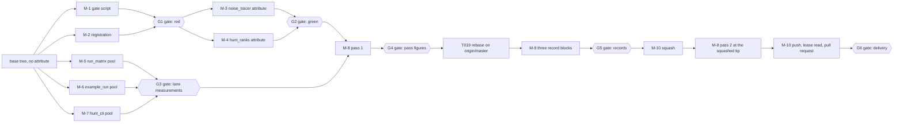
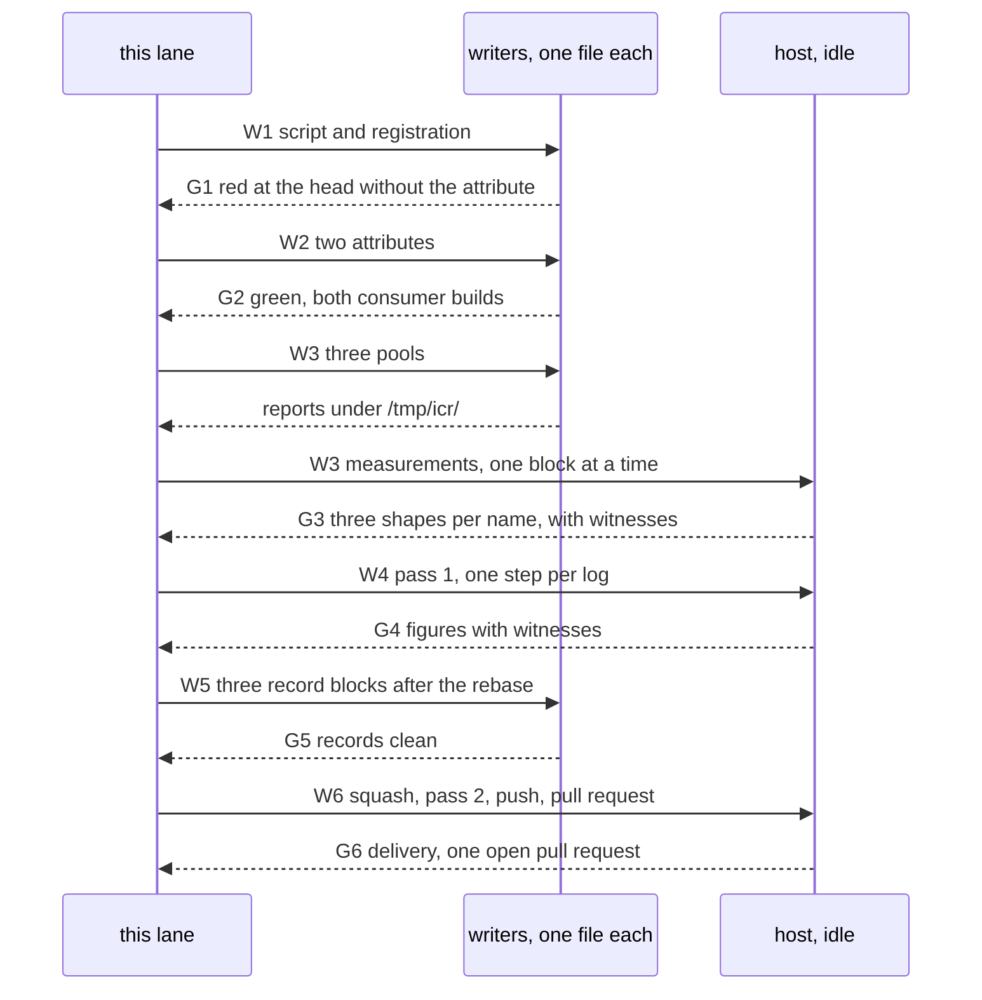

# Implementation Plan: Intel Closeout Repairs

**Branch**: `fix/intel-closeout-repairs` | **Date**: 2026-11-10 | **Spec**:
[spec.md](./spec.md)

**Input**: Feature specification from
`specs/052-intel-closeout-repairs/spec.md`

## Summary

Pull request #103 landed the second-pass figures and left four lines open: the
ignore-contract build, the sanitizer reds, the DBC target exit, and the paths
that name one operator's home. This lane closes all four in one commit on one
branch, and appends one dated repairs block to each record whose figures move.

The two build faults stand measured at the base and close with one attribute
each, in the shape the tree already carries at four sites. A new CTest entry
keeps them closed: one shell script compiles both files for the ignore
semantic and the enforce semantic with every compiler on `PATH`, and a planted
probe makes a scan that inspects nothing fail. The sanitizer reds are ceiling
costs, so the lane cuts wall time inside the drivers that own them: a bounded
pool in `test/base_cli/run_matrix.py` and in `test/example_run.sh`, both
proven against the instrumented binaries at 25.80 s and 56.39 s against 120 s
and 300 s ceilings, and the same shape over the 67 scenario children of
`test/source/harness_hunt_cli_test.cpp`. No ceiling moves and no case is lost.
`harness_jitter_cli_test` needs 548.74 s on the thread lane against a 300 s
ceiling, and the two levers that reach that ceiling stand outside the fence,
so that entry carries a blocked row that names them. The DBC target exits 0
once the tree is configured with `-D Python3_EXECUTABLE=/usr/bin/python3`,
measured at 349 interfaces and 0 gaps, so no shared gate file moves.

Three readings stand recorded as deviations in Complexity Tracking, and two
further rows there stand as registered P2 gaps under Principle VIII: the fence
holds one example file the order does not name; one head replaces the pair
ruling 29 names; the coverage verdict reads a host capture whose provenance
differs from the union the allowance counts; one entry keeps its ceiling on the
thread lane; and the coverage gate's own allowance wording is inherited.

## Technical Context

**Language/Version**: C++23 (`cxx_std_23`) for the two attributes and the one
test source; POSIX shell and Python 3 for the gate script and the two drivers.
No new standard, no new dependency.

**Primary Dependencies**: none added. The files this lane writes stand in
`source/harness/`, `example/docs/`, `test/` and `specs/`. The gate script
drives `c++` and `clang++` through the same include set the consumer trees
use, and the DBC target runs `python3` through the interpreter the cache
names.

**Storage**: no format, schema or file-layout change. The report schema stays
1.16 (`source/harness/json_report.cpp:58`), the harness stays `SOVERSION 22`
and the counters archive stays `SOVERSION 8`, because no public header and no
exported layout moves.

**Testing**: frameworkless C++ programs and shell drivers driven by CTest. One
new entry, `ignore_contracts_shape`, joins the two existing shape gates in the
Linux region of `test/CMakeLists.txt`. The suite shapes stay as CI runs them:
inside a lane directory,
`ctest --output-on-failure --no-tests=error -j "$(nproc)"` with the sanitizer
option strings the workflow sets.

**Target Platform**: Linux on x86-64. The lane host is CorsairOne (Intel Core
i9-9920X, 24 cpus, kernel `7.3.0-4-cachyos`, GCC 16.2.1 as `/usr/bin/c++`,
clang 23.1.3, lcov and genhtml 2.5.0-beta, `/usr/bin/python3` 3.14.8 with
PyYAML 6.0.3). macOS and Windows stay unsupported.

**Project Type**: benchmarking library with a harness library, one CLI and an
example set. This lane touches no library API, one example source, three test
drivers, one test source, one registration file and three records.

**Performance and scale targets**: none priced for the library. The lane cuts
wall time inside three test drivers, and every figure it prints carries its
own tree, its own shape and its own load witness.

**Configuration and feature flags**: `speedgun-ng_CONTRACTS=ignore` sets
`SG_CONTRACTS_SEMANTIC=0`, which the gate script also sets by hand.
`speedgun-ng_DEVELOPER_MODE` decides whether the example tree builds, which is
what splits the two consumer faults. `SPEEDGUN_SLOW_TESTS` and `MASTER_SKIP`
carry no new row (R-8).

**Constraints**: no ceiling value moves, no case or entry is dropped, no
sleep, clock or planted processor enters a test, no CI workflow, preset or
shared gate file changes, no path under the operator home lands in a row this
phase adds, no machine other than the host gets named (G-24), and the root
surface stays blocked with the right it lacks, in the shape the standing block
at `specs/048-hwlat-probe/results/acceptance-final-intel.md:1075-1080` gives.

**Scale/coverage**: 84 exclusion-marker lines within `source` and `include` at
the base, a coverage line metric at 100.0%, and a branch allowance of 21 rows
that the base has spent (R-11).

## Constitution Check

Standard first (P0): the two attributes rest on the standard's own
`[[maybe_unused]]`, and the pool in `run_matrix.py` uses the standard library
of the interpreter the entry already runs under. No non-standard construct
enters.

| Gate | Form this lane runs | State at plan time |
| --- | --- | --- |
| Release build, GCC | `cmake --preset=ci-rocky` then `cmake --build build` | green at `fe663b8d`, GCC 16.2.1 |
| Release build and suite, the CI test shape | `cmake --preset=ci-rocky` then `cmake --build build -j "$(nproc)"`, and the CI test-job commands run against that same tree | `CMakePresets.json` resolves `ci-rocky` and `ci-ubuntu-test` to one shape on this host: both inherit `ci-build`, `ci-linux`, `dev-mode` and `ci-cache`, both set `SPEEDGUN_DBC_MATRIX=ON`, and both write `binaryDir` `${sourceDir}/build`. `.github/workflows/ci.yml:503` runs `ci-ubuntu-test` with no `-B`, which is that same directory, so one tree carries the release gates and the CI test shape and no second copy of it stands built |
| Clang lanes | `CXX=clang++ cmake --preset=ci-sanitize -B build/sanitize` and `CXX=clang++ cmake --preset=ci-tsan -B build/tsan`, the directories each preset already names, then a build of each tree | CI pins `CXX: clang++` for both lanes at `.github/workflows/ci.yml:153` and `:236`; every figure row names the compiler of its tree |
| clang-tidy and cppcheck | `cmake --preset=ci-ubuntu -B build/analyzer` at T002, left unbuilt, then `set -o pipefail; cmake --build build/analyzer -j "$(nproc)" 2>&1 | tee /tmp/icr/pass1/analyzer-build.log` at T031, after T002 proved that directory absent | `build/analyzer` stands on this host already, configured `2026-11-08` with 364 objects, so a reconfigure there analyzes nothing and both launcher logs come back empty. The absence-before rule of the Physical view covers it, and the verdict needs a non-empty compile step |
| Name check | the `.clang-tidy` list under `WarningsAsErrors`, read with the step form of `.github/workflows/ci.yml:433` | the verdict is the count of findings on that list, which is `readability-identifier-naming`; an empty launcher log proves nothing |
| All tests pass | the suite shape of each lane at the tip | two lanes carry the reds this lane closes |
| Coverage 100% lines | `bash tools/dbc/coverage_gate.sh build/coverage/coverage.info` | the standing host capture answers 100.0% lines on `LF=18664` of `LH=18664` and a branch shortfall of 22 rows against the recorded allowance of 21, at exit 1, at a head earlier than this base; R-11 carries the reading rule |
| Prose and spell gates | `cmake -D PROSE_MODE=tree -P cmake/prose-lint.cmake`, `codespell` | green over the tree, 0 findings |
| Format | `cmake -D FORMAT_COMMAND=clang-format -P cmake/lint.cmake` | red at the base for two files this fence does not edit, `source/harness/jitter_probe.cpp` and `test/source/harness_jitter_probe_test.cpp`, both landed by PR #107, whose `lint` job failed in 37 s while 13 jobs skipped. `cmake/lint.cmake` globs the whole tree, so the gate reads red for every later lane, and twelve of thirteen jobs in `ci.yml` carry `needs: [lint]`. The lane pins that pair in `/tmp/icr/format-base.txt`, fails on a name beyond it, and the owner decides whether a format-only pull request lands first (R-19) |
| Page drift | the `example_drift` entry | green, and the attribute of R-7 lands outside the copied region |
| DBC gate | `cmake -S . -B build/dbc --preset=ci-ubuntu -D Python3_EXECUTABLE=/usr/bin/python3` then `cmake --build build/dbc --target dbc-gate`, the preset and target the CI job at `.github/workflows/ci.yml:1284` uses, in a directory of its own | exit 0, 349 interfaces and 0 gaps, read by R-12 in a `ci-rocky` tree under the interpreter of R-12; T001 re-reads it in the tree this row names. The target sits outside `ALL`, so no other gate runs it |

Design By Contract (II): the fix keeps every postcondition.
`activationAnswered` keeps its call at `SG_CONTRACTS_SEMANTIC=2` and keeps its
declaration at 0, which is the shape the four prior sites carry. No contract
macro, no `dbc.hpp` line and no contract semantic moves (FR-007).

R-DCUT and coverage (VI): the lane adds no branch to `source` or `include`, so
the line metric keeps 100.0%, the marker count stays 84 and the spent branch
allowance stays untouched. The two drivers keep every case and every
comparison.

Performance discipline (VII): the cost of each red stands measured before the
change, in three shapes with the load witness, and the change is the smallest
one that reaches the ceiling: a bounded pool over launches already counted,
with the per-launch cost printed in R-9 and R-10.

Anti-slop (X): three pools, two attributes, one script and one `add_test`. No
new abstraction, no helper that one caller uses, no defensive branch around a
pool, and no test that exists to satisfy a test.

Recorded deviations, carried to Complexity Tracking: the one example file
inside the fence (R-7), the single head in place of ruling 29's pair (R-3),
and the host coverage capture whose provenance differs from the union the
allowance counts (R-11). Two further rows in that table are not deviations:
they register a hard gate the tip cannot read green for, each with the clause
of Principle VIII it answers.

## Project Structure

### Documentation (this feature)

| Path | Change |
| --- | --- |
| `specs/052-intel-closeout-repairs/spec.md` | written, committed at `fe663b8d` |
| `specs/052-intel-closeout-repairs/checklists/requirements.md` | written, 16 of 16 |
| `specs/052-intel-closeout-repairs/research.md` | written, 18 entries |
| `specs/052-intel-closeout-repairs/plan.md` | this file |
| `specs/052-intel-closeout-repairs/tasks.md` | the task list this plan generates |
| `specs/048-hwlat-probe/results/acceptance-final-intel.md` | one dated repairs block, a correction list, and refreshed root rows |
| `specs/041-counter-probe/results/acceptance-final-intel.md` | one dated repairs block beside the blocked parity row |
| `specs/046-hunter-topdown/results/acceptance-final-intel.md` | a block only where a family figure moves (R-16) |

`.specify/feature.json` names this directory and stays uncommitted, so a
document pull request that edits it cannot collide with the branch (R-16).

### Source (this feature)

| Path | Module | Change |
| --- | --- | --- |
| `test/ignore_contracts_shape.sh` | M-1 | new gate script: two files, two semantics, every compiler, one planted probe |
| `test/CMakeLists.txt` | M-2 | one `add_test` inside the Linux region, with its comment |
| `source/harness/noise_tracer.cpp` | M-3 | `[[maybe_unused]]` and a reason comment at `:499` |
| `example/docs/hunt_ranks.cpp` (D-7) | M-4 | `[[maybe_unused]]` at `:147`, outside the copied region |
| `test/base_cli/run_matrix.py` | M-5 | 26 rows through a pool of six, one reroute name per row |
| `test/example_run.sh` | M-6 | 37 example files through a pool of six |
| `test/source/harness_hunt_cli_test.cpp` | M-7 | 67 scenario children through a pool of six |

Two paths sit beside those drivers and stay as they are: `test/data/base_cli_matrix.txt` keeps
all 26 rows for M-5, and the `example/docs/` units M-6 compiles keep their programs. No task
writes either one.

The fence these rows work inside is the Constraints list of `spec.md`, and that list is the
authority. D-7 carries the one path that joins it, and `tasks.md` points at the same list.

## Design

### Decision index

| decision | reading | research entry |
|---|---|---|
| D-1, D-2 | number, branch, base, and the one code tree | R-1, R-2 |
| D-3 | one head: the pass runs at the tip that carries the figures | R-3 |
| D-4, D-5 | gate red before fix; two names close the ignore build | R-4, R-5 |
| D-6 | `[[maybe_unused]]` with a reason comment | R-6 |
| D-7 | one example file joins the fence, recorded as a deviation | R-7 |
| D-8 | one script, one entry, inherited label and ceiling | R-8 |
| D-9, D-10 | ceiling costs, then pools inside the owned drivers | R-9, R-10 |
| D-11 | coverage reads one capture and prints its own denominator | R-11 |
| D-12 | the DBC target closes through its interpreter | R-12 |
| D-13, D-14 | `$HOME` spellings, and root stays blocked with today's reading | R-13, R-14 |
| D-15, D-16 | one commit, one lease, one pull request; the concurrent pull request | R-15, R-16 |
| extra | entry counts, the witness rule, the tool pins and the pass cost | R-17, R-18 |

### Modules and dependency order

One writer holds one file inside one wave. A child writes its report under
`/tmp/icr/` and stages nothing: the commits stand in this lane's own hand.

The `closes` column is a reading aid. The two maps further down this plan are
the authority for
which requirement runs where.

| module | file | writer | needs | closes |
|---|---|---|---|---|
| M-1 | `test/ignore_contracts_shape.sh` | one child | base tree, both compilers | FR-002, FR-003, FR-005, FR-006 |
| M-2 | `test/CMakeLists.txt` | one child | M-1 named | FR-005, FR-013 |
| M-3 | `source/harness/noise_tracer.cpp` | one child, with M-4 | M-1 and M-2 read red | FR-002, FR-004 |
| M-4 | `example/docs/hunt_ranks.cpp` (D-7) | same child as M-3 | M-1 and M-2 read red | FR-003, FR-004 |
| M-5 | `test/base_cli/run_matrix.py` | one child | a built `sanitize` and `tsan` tree | FR-009, FR-010, FR-011, FR-012 |
| M-6 | `test/example_run.sh` | one child | a built `sanitize` and `tsan` tree | FR-009, FR-010, FR-011, FR-012 |
| M-7 | `test/source/harness_hunt_cli_test.cpp` | one child | a built `sanitize` and `tsan` tree | FR-009, FR-010, FR-011, FR-012, FR-014 |
| M-8 | none, logs under `/tmp/icr/pass1/` and `/tmp/icr/pass2/` | this lane | M-1 to M-7 landed | FR-001, FR-010, FR-013, FR-015, FR-017, FR-018, FR-026 |
| M-9 | the three records | three children, one file each | M-8 figures, then the rebase | FR-007, FR-008, FR-016, FR-019 to FR-024, FR-029 |
| M-10 | none, git and `gh` only | this lane | M-9 committed | FR-025, FR-027, FR-028 |

The order is fixed by one fact: a tree that carries the attribute cannot
produce the red that proves the gate. So M-1 and M-2 land while the two
attributes stand reverted, the gate reads red at that head, and only then do
M-3 and M-4 land. M-5, M-6 and M-7 touch no file the first two waves touch, so
they run beside them.

### Waves, writers and gates

Each wave ends at its gate. A wave whose gate reads red stops the next one.

**W1, two writers in parallel.** M-1 writes the script, M-2 writes the
registration. Neither touches a source file. G1 runs against the `build` tree,
the CI test shape, so the entry count and the tier audit are read in the shape
CI counts.

```sh
# G1, in order, from the repository root
cmake --preset=ci-rocky && cmake --build build -j "$(nproc)"   # the release shape, which ci-ubuntu-test also resolves to
ctest --test-dir build --no-tests=error -R '^ignore_contracts_shape$' --output-on-failure   # red at this head
ctest --test-dir build -N 2>/dev/null | grep -c '^  Test '                                          # one more entry than the base count
bash test/tier_labels.sh build "$(command -v ctest)" && cmake -P cmake/lint.cmake && codespell
cmake -D PROSE_MODE=tree -P cmake/prose-lint.cmake
ctest --test-dir build --no-tests=error -R '^example_drift$' --output-on-failure
```

**W2, one writer.** M-3 and M-4 land together, because the developer consumer
tree needs both to reach its exit. T011 to T013 of W3 each read their own
driver's planted failure and verdict text at the base before that driver
changes, which is the reading Principle III asks of a driver that already
passes.

```sh
# G2
ctest --test-dir build --no-tests=error -R '^ignore_contracts_shape$' --output-on-failure   # green
cmake --build build/consumer-release -j "$(nproc)"                                          # exit 0
cmake --build build/consumer-release-dev -j "$(nproc)"                                      # exit 0
ctest --test-dir build --no-tests=error -R '^example_drift$' --output-on-failure
cmake -P cmake/lint.cmake
git diff --unified=0 -- source/harness/noise_tracer.cpp example/docs/hunt_ranks.cpp
```

G2 also reads the format diff: `clang-format` touches only the lines this lane wrote. A
formatting hunk outside them is a formatting-only change, and V forbids combining it with
content, so G2 reverts it and the squash carries no formatting hunk.

**W3, three writers in parallel.** M-5, M-6 and M-7 each hold one file. Builds
run together; every measurement runs alone, in the shape ruling 30 keeps, with
the load average printed before and after. Both sanitizer trees carry
`CXX=clang++`, because CI pins that compiler for both lanes and the base rows
were read from trees built with it.

```sh
# G3, one block per entry, run one after another with the host otherwise idle
cd build/sanitize && ASAN_OPTIONS="strict_string_checks=1:detect_stack_use_after_return=1:check_initialization_order=1:strict_init_order=1:detect_leaks=1:halt_on_error=1" UBSAN_OPTIONS="print_stacktrace=1:halt_on_error=1" ctest --output-on-failure --no-tests=error -R '^(base_cli_matrix|example_run|harness_hunt_cli_test|harness_jitter_cli_test)$'
cd build/tsan && TSAN_OPTIONS="halt_on_error=1:second_deadlock_stack=1" ctest --output-on-failure --no-tests=error -R '^(base_cli_matrix|example_run|harness_hunt_cli_test|harness_jitter_cli_test)$'
```

FR-010 asks three shapes per name, and each shape gets its own command in the
same directory: the bounded shape above, which carries the `TIMEOUT` the entry's
own existing registration carries, 120 s for `base_cli_matrix` and 300 s for the
rest; the parallel lane form of the wave gate, which is the same
command with `-j "$(nproc)"` and no `-R`; and the direct shape, which leaves
CTest behind, because the `TIMEOUT` property beats `--timeout`: a probe at
`/tmp/ctestprobe` registers a 3 s sleep with `TIMEOUT 1`, and
`ctest --timeout 100000` cuts it at 1.01 s. The direct shape runs the entry's
own executable from the tree's test directory, the form the base record's
ceiling controls print:

```sh
cd build/tsan/test && time ./harness_jitter_cli_test
```

**W4, this lane alone on a quiet host.** The full pass of FR-026 at the
candidate head, in `/tmp/icr/pass1/`: the release suite, the two pinned release
shapes, the sanitizer suite, the two pinned sanitizer shapes, the
thread-sanitizer suite, the two pinned thread-sanitizer shapes, the coverage
chain and gate, the prose, spell, page-drift, tier-label and format gates, both
consumer trees, the DBC target and the analyzer tree. Every figure row prints
`git diff --name-only <earlier head> <this head>` when the head it names differs
from the head an earlier row read, the proof clause ruling 29 asks of a figure
that changes head. The six pinned shapes stand in the base rows at
`specs/048-hwlat-probe/results/acceptance-final-intel.md:1636-1649` together
with `:298-299`, and each runs under the mask and job width its base row
names. Every step prints its
command, its exit, its wall time, its compiler and its load witness into its
own log.

**G4** closes the pass: the four lane counts, the six pinned shapes, the gate
line of the coverage run with its own denominators, the analyzer finding count
on the `WarningsAsErrors` list, and no row that lost its witness.

**W5, three writers in parallel after the rebase.** M-9a writes the block for
048, M-9b for 041, M-9c for 046 where a figure moved. Each reads the rebase
first, because a merged or later pull request moves lines in two of the three files (R-16).

```sh
# G5
cmake -D PROSE_MODE=tree -P cmake/prose-lint.cmake
cmake -D PROSE_MODE=range -D PROSE_BASE=origin/master -D PROSE_HEAD=HEAD -P cmake/prose-lint.cmake
codespell && cmake --build build/dbc --target dbc-gate
```

**W6, this lane.** One squash, the bounded second pass of FR-026 at that head
into `/tmp/icr/pass2/`, the convergence pass of `speckit-converge` before the
push, the push with the lease form, the remote read, and one pull request that
stays open. Convergence runs before the push because a write it appends would
otherwise move the head the matrix reports on; where it writes a tracked file
after the push, the bounded pass runs again at that head. The carried-figure
reading is ruling 29's two-head form, and it decides the analyzer and every
carried row: the row prints
`git diff --name-only <pass-1 head> <squashed head> -- include source test example cmake tools external CMakeLists.txt CMakePresets.json .clang-tidy .github/workflows`,
and where that prints nothing the row carries the first-pass verdict with both
heads named, while any name it prints sends the full list of the first pass
again.

**G6** closes the delivery: one commit between the base and the tip, the remote
hash equal to the local hash, one open pull request with no merge date, and the
pass-2 figures equal to the rows the record prints.

### UML design

Two diagrams carry the design in the form Principle IX asks for: the modules and
what they depend on, then the order the waves run in and the gate each one ends
at.



Two nodes name a state and no module: `B` is the base tree before either
attribute, and `RB` is the rebase step T019 owns.



### Logical view

Three behaviors change, and no interface does.

- The ignore semantic builds. A name whose only use sits inside a postcondition
  keeps compiling at both semantics, and one CTest entry keeps it that way on
  every compiler the host offers.
- Two entries stop losing their ceiling to a sibling. `base_cli_matrix` and
  `example_run` keep every case and start their children six at a time, so the
  wall falls from 117.86 s to 25.80 s and from 298.45 s to 56.39 s on the address
  lane while the verdict text stays word for word the same.
  `harness_hunt_cli_test` held its ceiling in both sanitizer lanes at the base
  and gains a pool so the coverage cut clears. `harness_jitter_cli_test` keeps
  its ceiling and carries a blocked row.
- One record block per moved figure. Each row names its head by handle, its
  tree, its compiler, its shape, its exit, its wall time and its load witness,
  and a blocked row names the right it lacks and the operator action that buys
  it.

### Physical view

Every tree below is built from a directory T002 proved absent or removed and
recorded the removal of, and each build prints the count of objects it produced.
A configure that finds a configured directory, a build that compiles nothing and
a launcher whose log stands empty are three shapes of one fault, and none of them
yields a verdict.

| Tree | Configure | Role |
| --- | --- | --- |
| `build` | `ci-rocky`, GCC, then `-D Python3_EXECUTABLE=/usr/bin/python3` | release gates and the CI test shape, which resolve to one shape (the row above) |
| `build/dbc` | `ci-ubuntu`, GCC, with `-D Python3_EXECUTABLE=/usr/bin/python3` | the DBC target, outside `ALL` |
| `build/analyzer` | `ci-ubuntu`, GCC, a directory T002 proved absent, configured and left unbuilt | clang-tidy and cppcheck over every translation unit, with the object count of its own first build printed by T031 |
| `build/sanitize` | `CXX=clang++` with the sanitizer preset | the address lane |
| `build/tsan` | `CXX=clang++` with the thread preset, built to completion before any figure | the thread lane |
| `build/coverage` | the coverage preset, GCC | the coverage chain and gate |
| `build/consumer-release` | `cmake --preset=ci-linux-ignore -B build/consumer-release` with `speedgun-ng_DEVELOPER_MODE=OFF` | the library consumer build |
| `build/consumer-release-dev` | `cmake --preset=ci-linux-ignore -B build/consumer-release-dev` with `speedgun-ng_DEVELOPER_MODE=ON` | the example consumer build, in its own directory because the preset names `build/ci-linux-ignore` for both |

Logs and scratch copies stay under `/tmp/icr/`: `pass1/` at the candidate head
and `pass2/` at the squashed head. Each log opens with its own command, its
head, its working tree state, its compiler and its load witness.

### Public API surface added

None. The lane adds one CTest entry, one shell script and three record blocks.
The report schema, both library `SOVERSION` values, the option set and every
contract macro keep the reading they carry at the base.

### Risks

| Risk | Reading that names it | Action carried |
| --- | --- | --- |
| The host coverage capture reads above 21 rows | `build/coverage/coverage.info` answers 22 rows at 9,273 branches today, at a tree with no code change | print the gate line, the allowance and both denominators of one run; name the capture as a host capture; where the excess rows are the PMU-gated rows of R-11, the row reads BLOCKED with the right it lacks and the run stands as a host reading |
| A pool gives a probe example a sibling | six of the 37 examples drive probes, and all 37 answered `PASS` at widths 4, 6 and 8 | print the width, keep the width one token, and fall to 4 if a `FAILED` or an undeclared `SKIPPED` row appears |
| The `harness_hunt_cli_test` pool is unproved | the 41.40 s figure came from a scratch driver over the same children, and the test source stands unmeasured | measure after the build; a figure without margin turns the entry into a blocked row naming its own file |
| A lane tree sits partly built | `build/tsan` registered `harness_hunt_cli_test` with no executable and scored it `Test Passed` in a parallel shape | build every tree to completion before a figure, read the entry count of the run, and void a row built on a tree that did not finish |
| A later merge moves record lines under the block | PR #104, #105, #106 and #107 landed 2026-11-10 and moved the tip to `1627e756`; the branch rebased onto it before any figure, and #104 corrected the six home-path lines D-13 named | rebase again before the squash, re-read every line cite after it, and write the appends after it |
| The remote moves during the work | the lease form of FR-027 | stop, record the reading, reconcile, push again under the same lease |
| The coverage picture step exits 2 | the target needs the Perl module `GD` | keep the gate step separate, print the target exit, and carry the operator action the base row prints |
| Figures drift between the two passes | wall times on a shared host | the row prints the pass it came from; a figure that moves gets rewritten and the pass runs again at the head that carries it |

## Test Plan

FR-029 asks each requirement to name its check and its evidence class. The
classes read:

- **F**, a fault check: non-zero at the base and zero at the tip.
- **I**, an invariant check: zero at both heads, beside one planted violation
  that answers non-zero.
- **P**, a process fact: read from the host or the remote, with no planted
  violation.

**Execution mode: TDD** (Principle III). The lane writes its check before the
change it guards, and the order proves it: T004 and T005 write the gate script
and its registration while both attributes stand reverted, T006 observes
`ignore_contracts_shape` answer exit 1 at that head, and only T008 and T009
turn it green. The driver wave carries the other shape of the rule, because a
driver already passes at the base and no fault reading stands available there:
T011 to T013 each print their own driver's planted failure and verdict text at
the base before they touch that driver, and T014 re-runs those two readings after
the change and diffs the child names and counts. The pair is the invariant class
FR-029 defines. A check that passed before
the change it guards would fail this rule, and the plan records the mode so a
reader can hold the lane to it.

### FR coverage map

The audit checks that live outside the repository sit under `/tmp/icr/audit/`,
because the fence adds one gate entry and no other registration. Each one
prints its command and its exit into the log the record cites.

| FR | class | check | runs at | module |
|---|---|---|---|---|
| FR-001 | P | every figure row prints head, tree and shape; `git rev-parse HEAD` at that head resolves the row | G4, G6 | M-8, M-9 |
| FR-002 | F | `ignore_contracts_shape` over `noise_tracer.cpp`: exit 1 at the base, exit 0 at the tip | G1, G2 | M-1, M-3 |
| FR-003 | F | the same entry printing `hunt_ranks.cpp` at both semantics: exit 1 at the base code tree with the check present, exit 0 at the tip | G1, G2 | M-1, M-4 |
| FR-004 | F | both consumer builds: exit 2 at the base, exit 0 at the tip, zero unused-name diagnostics | G2, G6 | M-3, M-4 |
| FR-005 | F | the entry itself, over two files in separate compile steps, two semantics and every compiler on `PATH`, with its wall time printed per compiler and per semantic | G1 | M-1, M-2 |
| FR-006 | I | the planted probe inside the script: the scratch copy fails the semantic-0 compile and passes the semantic-2 compile at both heads | G1, G2 | M-1 |
| FR-007 | I | `git diff --name-only 1f1f9b20 HEAD -- include/speedgun-ng/dbc.hpp` answers nothing, and a scratch copy with one planted header line answers non-zero | G5 | M-9 |
| FR-008 | I | version, schema and both `SOVERSION` values read at the tip equal the base values, and a scratch copy with one planted bump answers non-zero | G5 | M-9 |
| FR-009 | F, P | F over the entries that clear: the lane suite run in the CI form reads them green inside their ceiling at the tip, red at the base code tree with the pool absent. P over the blocked row's facts, which a plant cannot produce | G3, G6 | M-5, M-6, M-7 |
| FR-010 | P | three shapes per name: bounded alone, direct with no ceiling, and the parallel lane form, each with its exit and wall time | G3, G4 | M-5, M-6, M-7 |
| FR-011 | I | `git diff 1f1f9b20 HEAD -- test/CMakeLists.txt` moves no `TIMEOUT`, the diff of the four drivers adds no sleep, clock or processor pin, and a scratch diff with one planted ceiling change answers non-zero | G5 | M-5, M-6, M-7 |
| FR-012 | I | the verdict text keeps its count at both heads (`26 of 26 with all rows matching`, 37 `PASS:` lines), and a fixture that plants a failure still answers non-zero through the pool | G3 | M-5, M-6, M-7 |
| FR-013 | P | entry count per lane before and after the new registration | G1, G4, G6 | M-2, M-8 |
| FR-014 | P | a red outside the fence prints its reproduction and its owning path, and the fence diff shows no line changed for it | G3, G5 | M-7, M-9 |
| FR-015 | P | `bash tools/dbc/coverage_gate.sh build/coverage/coverage.info` at the tip, from one capture, with its own denominators, its exit, and the blocked clause of the requirement where the excess rows are the purchased ones; the class is a process fact, because the base capture at `208bc520` answered exit 0 and a fault check cannot read non-zero there | G4, G6 | M-8 |
| FR-016 | I | `git grep -c 'LCOV_EXCL' -- source include` summed equals 84, and a scratch copy with one planted marker answers non-zero | G5 | M-9 |
| FR-017 | P | each entry the coverage run cuts at its ceiling runs by hand from the coverage tree with its exit and wall time | G4 | M-8 |
| FR-018 | F | `cmake --build build/dbc --target dbc-gate`: exit 2 read at the base in T001 under the interpreter the cache picked, exit 0 at the tip under `/usr/bin/python3`, with the interface count of its own run; the target stays outside `ALL`, so only this check runs it | G5, G6 | M-8 |
| FR-019 | P | every blocked row this feature writes carries the field set that requirement lists, read by a scan of the new rows for each field, and for each borrower its named extra: the configure line and interpreter on the DBC row, the refreshed host reading on a root row, the first head that named the entry and its figures on a lane row, and both denominators on a coverage row | G5, G6 | M-8, M-9 |
| FR-020 | P | one dated block in 048 and 041, and in 046 only where a family figure moved | G5 | M-9 |
| FR-021 | I | a line-count audit of the blocks PR #99, #102 and #103 landed answers unchanged at the tip, and a planted deletion in a scratch copy answers non-zero | G5 | M-9 |
| FR-022 | I | a scan of the added and corrected rows answers zero paths under the operator home, and a planted absolute path in a scratch copy answers non-zero | G5 | M-9 |
| FR-023 | P | the root rows print today's readings, the right lacked, the operator line and the restore line, and stay BLOCKED | G5 | M-9 |
| FR-024 | I | a scan of the new rows names no machine other than the host `hostname` answers, and a scratch row with one planted machine name answers non-zero | G5 | M-9 |
| FR-025 | P | one commit between the base and the tip after the rebase, and a body that prints the hash, the counts, the root status and the deferred causes | G6 | M-10 |
| FR-026 | P | the first-pass log at the candidate head: four lanes, the six pinned shapes, the coverage chain and gate or the blocked clause of FR-015, the analyzer tree, the prose, spell, page-drift, tier-label and format gates, both consumer trees and the DBC target or its blocked row, each with its exit; and the second-pass log at the squashed head: the six pinned shapes, that chain and gate, those gates and that target, with every carried figure printing its two-head diff | G4, G6 | M-8 |
| FR-027 | P | `git ls-remote origin refs/heads/fix/intel-closeout-repairs` equals the local head after each push | G6 | M-10 |
| FR-028 | P | `gh pr view` answers one open pull request with no merge date, and issue #76 stays open | G6 | M-10 |
| FR-029 | P | this map, one row per requirement, with the gate each check runs at, read by T029 and T030 of phase 8 | G5, phase 8 | M-9 |
| FR-030 | I | the prose, spell and drift gates answer zero in both forms at both heads, and a planted banned token in a scratch copy of the new text answers non-zero | G1, G5, G6 | M-9 |

### Success-criterion map

| SC | class | check | runs at | module |
|---|---|---|---|---|
| SC-001 | F | both consumer builds exit 0 at the tip, and the unused-name diagnostics they print count zero | G2, G6 | M-3, M-4 |
| SC-002 | F, I | F: the entry FR-005 names answers exit 1 at the base code tree and exit 0 at the tip. I: the probe FR-006 plants answers exit 1 at semantic 0 and exit 0 at semantic 2 at both heads | G1, G2 | M-1 |
| SC-003 | F | the lane suite run at the tip counts zero entries in neither of the two states FR-009 names | G3, G4 | M-5, M-6, M-7, M-8 |
| SC-004 | I | the FR-011 diff reads empty, each driver this lane changed keeps its base case count, and a scratch copy with one planted dropped case answers non-zero | G3, G5 | M-5, M-6, M-7 |
| SC-005 | P | the gate line of one capture with both denominators, or the blocked clause of FR-015, beside the marker count 84 | G4, G5 | M-8 |
| SC-006 | P | the DBC row prints the command a reader can copy, the interpreter it found and the exit it answered | G5 | M-8, M-9 |
| SC-007 | I | the home-path scan answers zero over the added rows, the correction rows keep the figures they answer, and a planted absolute path answers non-zero | G5 | M-9 |
| SC-008 | P | one commit between base and tip, the remote hash equal to the local hash, the body printing it, and the pull request open with no merge | G6 | M-10 |
| SC-009 | I, P | I: the prose, spell and drift gates read zero at both heads, and a planted banned token answers non-zero. P: every lane prints its suite count beside its figures, the reading FR-013 owns | G4, G5, G6 | M-8, M-9 |

### Coverage plan

One capture answers FR-015: `build/coverage/coverage.info`, written by the
tracked chain at the tip on this host, in one run, with no `--ignore-errors`
flag and no new exclusion marker. The row prints the path, the head, the gate
line and both denominators of that run.

The allowance counts the union of the CI coverage job, where every entry runs
to its end. A host capture is a different provenance: an entry there can stop
early and leave the arms past its stop dark, and the ledger at
`tools/dbc/coverage_gate.sh:61-107` names six rows that buy with the root
right. Two host readings stand in this plan and they stay apart:

| capture | provenance | lines | branches | gate |
| --- | --- | --- | --- | --- |
| written 2026-11-08 under `build/coverage/`, from a chain that did not finish | this host, partial | 100.0% over 18,664 of 18,664 | 99.8% over 9,251 of 9,273 | exit 1, `branch shortfall 22 rows exceeds the ... allowance of 21` |
| the closeout chain at `208bc520` | this host, complete (`specs/048-hwlat-probe/results/acceptance-final-intel.md:1674-1680`) | 100.0% over 18,683 of 18,683 | 99.8% over 9,263 of 9,283 | exit 0, `branch shortfall 21 rows, within the ... allowance of 21` |

The two line totals differ by 19 lines because the captures cover different
file sets. No row blends them, and every row names the run its denominator
came from.

At the tip the chain runs to its end but for the entry FR-009 blocks, whose row
prints the ceiling cut of 300 s and the hand run of 482 s the base record prices
for it. The gate runs on the capture it wrote,
and the verdict follows the exit. Where the exit is not 0, the row prints the
gate line, lists the rows that stand dark and names the entry whose stop left
each one dark. Where those rows are the six the ledger names, the row states
BLOCKED with the right it lacks in the shape FR-023 gives a root row, and the
host reading stands beside it as a labeled reading. The line metric keeps its
own row, so a reader sees which of the two metrics the gate answered on. The
gate script also exits 2 for a usage fault and 3 when the capture tool fails;
either exit prints the tool's own complaint and the command in a row that names
no verdict. The picture step of the coverage target exits 2
for want of the Perl module `GD`; the gate reads a text summary, so the two
steps keep two rows and the operator action the base row prints stands where
it is.

### Gate commands

The record copies these forms and their exits. A form rewritten in prose is a
different command, and CMake ignores a `-D` written after `-P`.

The prose, spell and format gates above run through one untracked script before
every commit:
`/tmp/icr/gate-run.sh`. It adds an audit of the four documents of this feature:
a code span split across a line break, a token Principle XI bars, a double space
outside a quoted command, a task id that stands missing from `tasks.md`, and a
cited task id that resolves nowhere. The script exits non-zero when any step
fails, so a commit cannot land on a reading it did not check. The audit stays
outside the tree, because the fence admits one new gate script and that is
`test/ignore_contracts_shape.sh`.

```sh
# prose, spell and format gates
cmake -D PROSE_MODE=tree -P cmake/prose-lint.cmake
cmake -D PROSE_MODE=range -D PROSE_BASE=origin/master -D PROSE_HEAD=HEAD -P cmake/prose-lint.cmake
codespell
cmake -P cmake/lint.cmake
ctest --test-dir build --no-tests=error -R '^example_drift$' --output-on-failure
# the ignore-semantic gate and the two consumer trees
ctest --test-dir build --no-tests=error -R '^ignore_contracts_shape$' --output-on-failure
cmake --build build/consumer-release -j "$(nproc)"
cmake --build build/consumer-release-dev -j "$(nproc)"
# DBC, in its own tree, because the CI test job and the DBC job use different presets
cmake -S . -B build/dbc --preset=ci-ubuntu -D Python3_EXECUTABLE=/usr/bin/python3
cmake --build build/dbc --target dbc-gate
# lanes, run one after another on a host that carries nothing else
cd build && ctest --output-on-failure --no-tests=error -j "$(nproc)"
cd build/sanitize && ASAN_OPTIONS="strict_string_checks=1:detect_stack_use_after_return=1:check_initialization_order=1:strict_init_order=1:detect_leaks=1:halt_on_error=1" UBSAN_OPTIONS="print_stacktrace=1:halt_on_error=1" ctest --output-on-failure --no-tests=error -j "$(nproc)"
cd build/tsan && TSAN_OPTIONS="halt_on_error=1:second_deadlock_stack=1" ctest --output-on-failure --no-tests=error -j "$(nproc)"
cd build/coverage && ctest --output-on-failure --no-tests=error -j "$(nproc)"
bash tools/dbc/coverage_gate.sh build/coverage/coverage.info
# the two pinned release shapes of the base rows
taskset -c 0,1 ctest --test-dir build --output-on-failure --no-tests=error -C Release -j 2
taskset -c 0,1,2,3 ctest --test-dir build --output-on-failure --no-tests=error -C Release -j 4
# counts, fence audit and constants
for lane in build build/sanitize build/tsan build/coverage; do printf '%s ' "$lane"; ctest --test-dir "$lane" -N 2>/dev/null | grep -c '^  Test '; done
git diff --name-only origin/master HEAD
git grep -c 'LCOV_EXCL' -- source include
# delivery
git push -u origin fix/intel-closeout-repairs
git push --force-with-lease=fix/intel-closeout-repairs:<expected-full-sha>
git ls-remote origin refs/heads/fix/intel-closeout-repairs
```

Three forms appear in this plan and in `tasks.md`, two documents this feature
tracks, and appear in no other tracked file: `cmake --build <tree> -j "$(nproc)" -- -k`,
`git diff --name-only c9187ba3..1f1f9b20 -- include source test example tools cmake .github CMakeLists.txt CMakePresets.json`,
and `git log --oneline 1f1f9b20..HEAD`. A sweep of quoted forms reads these
three as the composed exceptions.

## Constitution Check: design re-check

The check ran before the design and runs again after it, and the answer is the
same: three named exceptions, plus two registered P2 gaps in Complexity
Tracking.

- No dependency, no standard, no public header, no `SOVERSION` and no schema
  value moves (FR-008). The library surface grows by nothing.
- No ceiling, no label, no fixture case and no preset moves. The pools change
  the order in which launches start, and each driver keeps its verdict text.
- No contract macro moves, and the ignore semantic keeps its meaning: the fix is
  an attribute the tree already carries at four sites.
- The coverage chain gains no branch in `source` or `include`, so the spent
  branch allowance stays spent by the base and untouched here.
- Exception one, in the fence: one example file the order does not name (R-7),
  carried in Complexity Tracking with its one-revert path.
- Exception two, in the record: one head where ruling 29 names two, because the
  pass runs at the tip that carries the figures (R-3).
- Exception three, in the record: a host capture where the allowance counts a
  union (R-11), carried as a BLOCKED row with the right it lacks, and the row
  names no regression.

## Complexity Tracking

| Deviation | Why the lane takes it | Where it stands recorded | Path back |
| --- | --- | --- | --- |
| `example/docs/hunt_ranks.cpp` joins the fence | the developer consumer build stops there, and no file the order names can clear it | spec D-7 with the order's fence line quoted, and R-7 | revert the attribute at `:147` and write the blocked row of Reading 2 |
| One head where ruling 29 names two | a commit cannot carry its own hash, and the pass runs at the tip that carries the figures | spec D-3 and R-3 | return to the two-head form, which costs one further squash and a markdown-only delta |
| A host capture answers the coverage gate | no hosted runner stands open to this lane, and the CI union is not this host's to produce | spec D-11, R-11 and the coverage plan above | a hosted union capture, which the root right and a runner both buy |
| The analysis loop stops once it meets a bound | the owner set the bound on 2026-11-10 after three rounds answered 46, 29 and 37 findings in 85, 28 and 70 minutes of reader time, because each round grows the text the next round judges | spec D-17, the stop line of T029, and this row | a further full-artifact round, which the owner can call at any point |
| The second pass covers less than the first | the owner set the bound on 2026-11-10 with the price in front of them: 6.8 h for one pass and 13.6 h for two, and only markdown lands between the two heads | spec D-17, FR-026's carried-figure clause and T026 | any code name in `git diff --name-only <first-pass head> <squashed head> -- include source test example` sends the full second pass |
| Two files at the base fail the format gate | `source/harness/jitter_probe.cpp` and `test/source/harness_jitter_probe_test.cpp` landed unformatted with PR #107, whose `lint` job failed in 37 s, and `cmake/lint.cmake` globs the whole tree, so the gate reads red for this lane too and twelve of thirteen CI jobs stand behind it | R-19, the Format row of the gate table, and the pinned set `/tmp/icr/format-base.txt` the lane gate compares against | a format-only pull request onto `master` that this branch then rebases onto in T019, or the owner widening the fence by those two paths |
| One entry stays red on the thread lane | its 548.74 s against a 300 s ceiling is owned by the ceiling and by the instrumented start inside `source/harness/jitter_probe.cpp` and `source/harness/runner.cpp`, and 499.65 s of it stands outside any constant in the test file (R-10) | the blocked row of FR-009 cites the `All tests pass` and thread-sanitizer gates of Principle VIII and registers the gap as a P2 with the written justification VIII asks for | a pool inside a `RUN_SERIAL` entry, which the ruling forbids, or a ceiling change, which the fence refuses |
| The coverage gate prints an allowance while its own text reads 100% | inherited at `tools/dbc/coverage_gate.sh:108` before this feature, and this lane changes no shared gate file | the coverage rows print both denominators and the allowance beside the exit, and the finding stands carried to Governance as a P2 or an amendment | an edit to a shared gate script, which the fence refuses |
